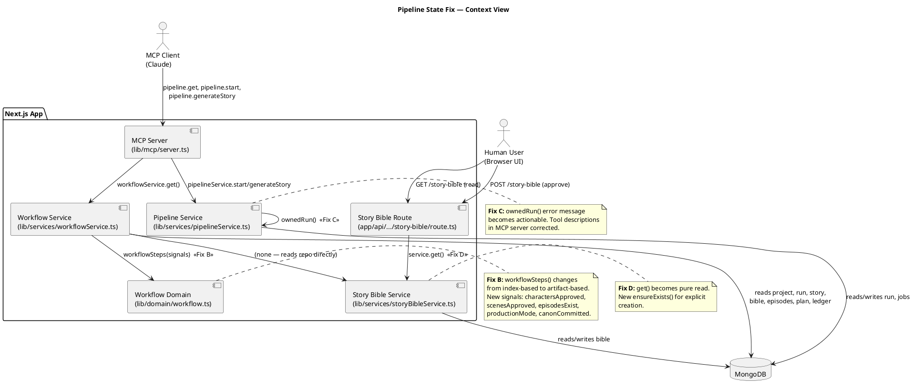
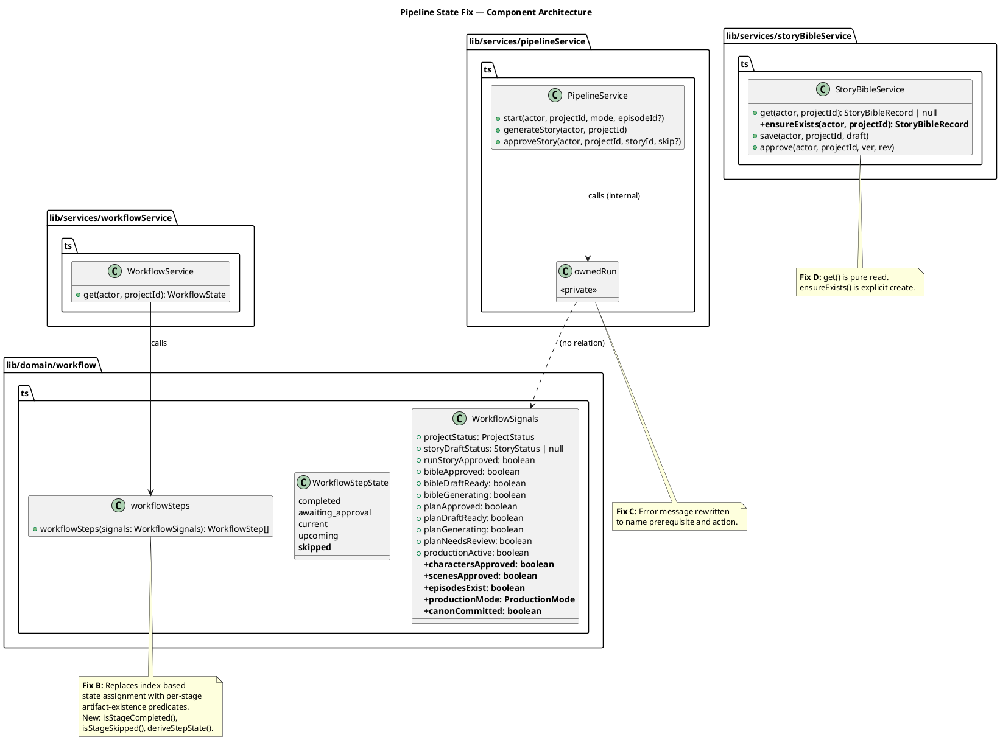
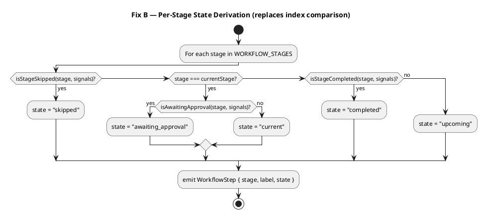
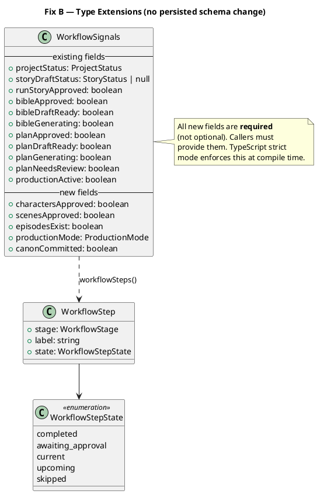

# MCP Pipeline State Fix — Technical Design

**Date:** 2026-11-28
**Status:** Draft (Design Creation phase)
**Scope:** Bug fixes B, C, D from Phase 1 investigation. Fix A requires no code change (human UI action).
**Affected project:** `6b0ad8322a2fc3703d530906` ("The Last Voice", standalone, 300s, 16:9)
**Affected bible:** `6b0ad8ae5bfa0b00c806923b`

---

## 1. Analysis of Relationships Between Requirements and Existing Features

### 1.1 Comparison of Requirement Features and Existing Features

The three confirmed code defects (B, C, D) map to distinct functions in the workflow, pipeline, and story-bible modules. The table below compares each requirement against the existing implementation.

#### 1.1.1 Implemented Features (exact or near match)

| Requirement Feature | Existing Feature | Code Location | Match Level |
|---------|---------|---------|--------|
| Fix A: Bible approval state | `storyBibleRepository.approve()` is the only code that writes `approvedVersion`/`approvedSnapshot`. Called only by `storyBibleService.approve()`, which has exactly two entry points: MCP `bible.approve` and UI `POST /story-bible`. | `lib/repositories/storyBibleRepository.ts:206-247`, `lib/services/storyBibleService.ts:60-71`, `lib/mcp/server.ts:1439-1453`, `app/api/projects/[projectId]/story-bible/route.ts:29-37` | 100% (no change needed) |
| Workflow stage derivation | `deriveWorkflowStage()` correctly returns the current stage from signals (bible → story → episodes → production_design). | `lib/domain/workflow.ts:167-185` | 100% (derivation is correct; only step-state labeling is wrong) |
| Pipeline run creation | `pipelineService.start()` creates a `ProductionRun` at the story stage with `status: "running"`. | `lib/services/pipelineService.ts:130-194` | 100% (behavior is correct; only the tool description overpromises) |
| Story-bible repository read | `storyBibleRepository.findOwned()` is a pure read — returns `null` when no bible exists. | `lib/repositories/storyBibleRepository.ts:75-80` | 100% (repository is already side-effect-free) |
| MCP `document.get` for bible | Calls `storyBibleRepository.findOwned()` directly and returns `bible ?? { message: "No Story Bible found" }`. No side effect. | `lib/mcp/server.ts:489-492` | 100% (MCP reads are already pure) |
| MCP `document.update` with `confirm=false` | Returns a preview object without calling any service or repository. No side effect. | `lib/mcp/server.ts:529-537` | 100% (preview is already pure) |

#### 1.1.2 Features Requiring Extension

| Requirement Feature | Existing Feature | Difference Description | Extension Direction |
|---------|---------|---------|---------|
| **Fix B:** Step states must reflect real artifacts | `workflowSteps()` marks stages "completed" by array index: `index < currentIndex → "completed"`. | **Input difference:** Current logic uses only `currentIndex` (positional). Required logic must use per-stage artifact-existence signals. **Business logic difference:** `WORKFLOW_STAGES` display order places `episodes` (index 3), `characters` (4), `scenes` (5) before `story` (6), but execution order is story → characters → scenes. With `currentStage="story"`, stages 0-5 are all marked "completed" even when no episodes, characters, or scenes exist. **Boundary difference:** No "skipped" state exists for stages intentionally bypassed (e.g., standalone mode skips episodes). | 1. Add `"skipped"` to `WorkflowStepState` union. 2. Extend `WorkflowSignals` with artifact-existence fields (`charactersApproved`, `scenesApproved`, `episodesExist`, `productionMode`, `canonCommitted`). 3. Replace index-based logic in `workflowSteps()` with per-stage `isStageCompleted()` / `isStageSkipped()` predicates. 4. Update `workflowService.get()` to compute and pass the new signals. 5. Update `WorkflowState` type if needed for "skipped" propagation. |
| **Fix C:** Actionable error when no run exists | `ownedRun()` throws `StudioError("Start a production before this step", 409, "run_required")`. | **Output difference:** Message is vague — does not name the missing prerequisite ("no production run") or the exact action ("call pipeline.start"). **Documentation difference:** `pipeline.start` tool description says "kicks off story → characters → scenes → render workflow" but it only creates an empty run and enqueues nothing. `generateStory` description does not mention the run prerequisite. | 1. Rewrite `ownedRun()` error message to name the prerequisite and action. 2. Rewrite `pipeline.start` tool description to accurately state it creates a run at story stage without enqueuing, and document guided vs automatic gate behavior. 3. Rewrite `pipeline.generateStory` tool description to mention the run prerequisite. |
| **Fix D:** Reads must not create records | `storyBibleService.get()` creates an empty bible via `saveDraft()` when none exists: `findOwned() ?? saveDraft({...})`. | **Input/output difference:** `get()` returns `StoryBibleRecord` (never null) and has a write side effect. Required: `get()` returns `StoryBibleRecord | null` with no write. **Business logic difference:** The UI GET route calls `service.get()` on every page load, creating an empty bible record as a side effect of a read. **Boundary difference:** Existing tests (`tests/story-bible.test.ts:92,108,120`) depend on `get()` creating the record. | 1. Change `storyBibleService.get()` to a pure read returning `null`. 2. Add explicit `ensureExists()` method for callers that need creation. 3. Update UI GET route to handle `null` by returning `{ bible: null }`. 4. Update `useStoryBible` hook type to `StoryBibleRecord | null`. 5. Update tests to use `ensureExists()` or `save()` for setup. |

#### 1.1.3 Features or Interfaces Requiring New Development

No entirely new modules are needed. The fixes extend existing types and functions:

**Fix B — New type members and predicate functions:**
- `WorkflowStepState` union: add `"skipped"`.
- `WorkflowSignals` type: add `charactersApproved`, `scenesApproved`, `episodesExist`, `productionMode`, `canonCommitted` fields.
- New pure functions: `isStageCompleted(stage, signals)`, `isStageSkipped(stage, signals)`, `deriveStepState(stage, current, signals)`.
- Dependency: imports `ProductionMode` from `lib/domain/projectCatalog`.

**Fix C — No new code structures; only string constants and documentation:**
- The error message and tool descriptions are string literals. No new types.

**Fix D — New service method:**
- `storyBibleService.ensureExists(actor, projectId)`: creates an empty bible if none exists, returns the record. This is the explicit "create if absent" that was previously hidden inside `get()`.

---

### 1.2 Detailed Analysis of Existing Features

#### 1.2.1 `workflowSteps()` — Current Interface Contract and Constraints

**Interface contract:**
- **Input:** `WorkflowSignals` (11 boolean/enum fields describing project state).
- **Output:** `WorkflowStep[]` — one entry per `WORKFLOW_STAGES` element (13 stages), each with `{ stage, label, state }`.
- **Exceptions:** None (pure function).
- **Side effects:** None.

**Business rules (current):**
1. Compute `current = deriveWorkflowStage(signals)`.
2. Compute `currentIndex = WORKFLOW_STAGES.indexOf(current)`.
3. For each stage at `index`: if `index < currentIndex → "completed"`; if `index > currentIndex → "upcoming"`; if `index === currentIndex` and `isAwaitingApproval → "awaiting_approval"`; else `"current"`.

**Constraint violated:** The index comparison assumes `WORKFLOW_STAGES` array order equals execution order. It does not. The display order is `episodes → characters → scenes → story` (indices 3, 4, 5, 6) but execution order is `story → characters → scenes`. This causes stages with no artifacts to be labeled "completed".

**Extension points:** `WorkflowSignals` is a plain data type; adding fields is backward-compatible if callers are updated. `workflowSteps()` is called only by `workflowService.get()` (production) and test helpers.

**Thread safety:** Pure function, no concurrency concerns.

#### 1.2.2 `ownedRun()` — Current Interface Contract and Constraints

**Interface contract:**
- **Input:** `PipelineDeps`, `RequestAuth`, `projectId: string`.
- **Output:** `RunRecord` (the latest production run for the project).
- **Exceptions:** `StudioError("Start a production before this step", 409, "run_required")` when no run exists.
- **Side effects:** None (read-only).

**Business rules:** Calls `deps.runs.findLatest(userId, projectId)`. Returns the run if found. Throws if not.

**Constraint violated:** The error message is not actionable — it does not name the missing prerequisite (no production run) or the exact tool to call (`pipeline.start`). An MCP client cannot determine what to do next.

**Callers:** `generateStory()`, `approveStory()`, `updateStory()`, `approve()`, `generateScenes()`, `retry()`, `retryScene()`, `cancel()`. All are pipeline operations that require an existing run.

#### 1.2.3 `storyBibleService.get()` — Current Interface Contract and Constraints

**Interface contract:**
- **Input:** `RequestAuth`, `projectId: string`.
- **Output:** `StoryBibleRecord` (never null — creates if absent).
- **Exceptions:** `StudioError("Project not found", 404, "not_found")` if the project doesn't exist or the bible can't be created.
- **Side effects:** **Write** — calls `repository.saveDraft()` when no bible exists, creating an empty record with `draftRevision: 1`.

**Business rules:** `findOwned() ?? saveDraft({ premise: "", ... })`. The fallback creates an empty bible via upsert.

**Constraint violated:** A read operation (`get`) has a write side effect. This violates the principle that reads, previews, and `confirm=false` calls should be free of side effects. The UI GET route triggers this on every page load, creating a bible record even if the user only previewed content via MCP.

**Extension points:** The service factory `createStoryBibleService(repository, projects)` returns an object with `get`, `save`, `approve`. Adding `ensureExists` is a non-breaking addition.

**Dependencies:** `storyBibleRepository.saveDraft()` performs a MongoDB upsert with `$inc: { draftRevision: 1 }`. The side effect is durable and visible to all subsequent reads.

---
## 2. Incremental Design Solution

### 2.1 Implementation Model

#### 2.1.1 Context View

The fixes touch three modules that participate in the workflow derivation chain. The context diagram below shows the interaction relationships.



**Call frequencies:**
- `workflowService.get()` → `workflowSteps()`: once per `pipeline.get` MCP call and once per UI workflow hook refresh (polling).
- `ownedRun()`: once per pipeline operation (generateStory, approve, etc.).
- `storyBibleService.get()`: once per UI bible page load.

#### 2.1.2 Service/Component Overall Architecture

The fixes do not change the module boundaries. They change the internal logic of three functions and extend two types. The component diagram shows the affected interfaces.



**Configuration items:** No new configuration or environment variables are introduced.

#### 2.1.3 Implementation Design — State Derivation Flow

The core logic change is in `workflowSteps()`. The state machine below shows how each stage's state is derived under the new logic.



**Key design decision — evaluation order:**

1. **Skipped first:** A stage that is intentionally bypassed by design (e.g., `episodes` in standalone mode) is always "skipped", regardless of artifact state. This prevents a skipped stage from ever showing "completed" or "upcoming".
2. **Current second:** The stage returned by `deriveWorkflowStage()` is the one the user should act on. It is "current" or "awaiting_approval" even if partial artifacts exist (e.g., a plan that needs review).
3. **Completed third:** A stage whose artifacts exist is "completed". This is checked after "current" so that a stage needing review (current) is not mislabeled as completed.
4. **Upcoming otherwise:** Stages after the current one with no artifacts are "upcoming".

**Rationale:** This order ensures that (a) skipped stages are never confused with completed ones, (b) the current stage always shows as actionable, and (c) completed stages are determined by real artifacts, not position.

---

### 2.2 Interface Design

#### 2.2.1 Overall Design

| Interface | Type | Stability | Change |
|-----------|------|-----------|--------|
| `WorkflowStepState` | Type union | Stable | Add `"skipped"` member |
| `WorkflowSignals` | Type (input to `workflowSteps`) | Stable | Add 5 required fields |
| `workflowSteps(signals)` | Pure function | Stable | Internal logic change; signature unchanged |
| `isStageCompleted(stage, signals)` | New pure function | Experimental (new) | Per-stage artifact predicate |
| `isStageSkipped(stage, signals)` | New pure function | Experimental (new) | Per-stage skip predicate |
| `deriveStepState(stage, current, signals)` | New pure function | Experimental (new) | Orchestrates the state derivation |
| `ownedRun(deps, actor, projectId)` | Private function | Stable | Error message text change only |
| `storyBibleService.get(actor, projectId)` | Service method | Stable | Return type changes: `StoryBibleRecord` → `StoryBibleRecord | null` |
| `storyBibleService.ensureExists(actor, projectId)` | New service method | Experimental (new) | Explicit create-if-absent |
| `pipeline.start` MCP tool | Tool description | Stable | Description text corrected |
| `pipeline.generateStory` MCP tool | Tool description | Stable | Description text corrected |

**Interface change strategy:** The `WorkflowSignals` type extension is additive (new required fields). All callers (`workflowService.get()` and test helpers) must be updated to provide the new fields. The `storyBibleService.get()` return type change is narrowing the output (was never null, now can be null) — callers must handle null. Both changes are type-checked at compile time (TypeScript strict mode), so the compiler will flag all affected call sites.

#### 2.2.2 Interface List

##### `workflowSteps(signals: WorkflowSignals): WorkflowStep[]`

**Signature:** Unchanged.
```typescript
export function workflowSteps(signals: WorkflowSignals): WorkflowStep[];
```

**Business description:** Derives the display state of every workflow stage from artifact-existence signals. Replaces the previous index-based logic.

**Preconditions:** `signals` must include all fields (including the 5 new ones). `deriveWorkflowStage(signals)` must return a valid `WorkflowStage`.

**Postconditions:** Returns exactly `WORKFLOW_STAGES.length` entries. Each entry has a `state` that is one of `"completed"`, `"awaiting_approval"`, `"current"`, `"upcoming"`, `"skipped"`. Exactly one stage has `state === "current"` or `state === "awaiting_approval"` (unless all stages are completed/skipped).

**Exception mapping:** None (pure function).

##### `isStageCompleted(stage: WorkflowStage, signals: WorkflowSignals): boolean`

**Signature:**
```typescript
function isStageCompleted(stage: WorkflowStage, signals: WorkflowSignals): boolean;
```

**Business description:** Returns `true` when the stage's artifacts exist and the stage is genuinely done. This is the artifact-existence check that replaces the index comparison.

**Per-stage completion predicates:**

| Stage | Completed when | Signal(s) used |
|-------|---------------|----------------|
| `project_setup` | `true` (project exists to compute steps) | — |
| `planning` | `signals.bibleApproved` (creative planning feeds the bible; once the bible is approved, planning is done) | `bibleApproved` |
| `bible` | `signals.bibleApproved` | `bibleApproved` |
| `episodes` | `signals.planApproved && signals.episodesExist` | `planApproved`, `episodesExist` |
| `characters` | `signals.charactersApproved` | `charactersApproved` |
| `scenes` | `signals.scenesApproved` | `scenesApproved` |
| `story` | `storyIsApproved(signals)` | `storyDraftStatus`, `runStoryApproved`, `projectStatus` |
| `canon` | `signals.canonCommitted` | `canonCommitted` |
| `production_design` | `signals.productionActive` | `productionActive` |
| `audio` | `signals.productionActive` (audio is part of production; no separate signal in minimal fix) | `productionActive` |
| `video` | `signals.productionActive` | `productionActive` |
| `timeline` | `signals.productionActive` | `productionActive` |
| `rendering` | `signals.productionActive && signals.projectStatus === "completed"` | `productionActive`, `projectStatus` |

**Rationale for `audio`/`video`/`timeline` using `productionActive`:** In the minimal fix, we do not add granular signals for every production sub-stage. `productionActive` indicates the production run has moved past the story stage into character/scene/media/render work. These stages are only "completed" when the entire production is active. A future iteration can add `audioReady`, `videoReady`, `timelineExists`, `renderComplete` for finer granularity. For now, this prevents the reported bug (stages before story marked completed) without over-engineering.

##### `isStageSkipped(stage: WorkflowStage, signals: WorkflowSignals): boolean`

**Signature:**
```typescript
function isStageSkipped(stage: WorkflowStage, signals: WorkflowSignals): boolean;
```

**Business description:** Returns `true` when a stage is intentionally bypassed by design (not by missing data).

**Per-stage skip predicates:**

| Stage | Skipped when | Rationale |
|-------|-------------|-----------|
| `episodes` | `signals.productionMode === "standalone"` | Standalone productions have no seasons or episodes. The Season & Episodes stage does not apply. |
| `planning` | `signals.productionMode === "standalone"` | Standalone productions skip season/episode planning. The "Creative Planning" stage is part of the serialized planning flow. |
| All other stages | `false` | No other stages are skipped by production mode. |

**Note on `planning` skip:** The `planning` stage ("Creative Planning") in `WORKFLOW_STAGES` is distinct from the `bible` stage. In serialized mode, creative planning precedes the bible. In standalone mode, the creator goes directly to the bible. This is the most conservative interpretation. If `planning` is found to be a universal precursor (not skipped in any mode), this predicate can be relaxed to return `false` for `planning` without affecting the core fix. **Flagged as assumption — see Section 9.**

##### `deriveStepState(stage, current, signals): WorkflowStepState`

**Signature:**
```typescript
function deriveStepState(
  stage: WorkflowStage,
  current: WorkflowStage,
  signals: WorkflowSignals,
): WorkflowStepState;
```

**Business description:** Orchestrates the state derivation for a single stage. Implements the evaluation order: skipped → current/awaiting → completed → upcoming.

##### `ownedRun(deps, actor, projectId): Promise<RunRecord>`

**Signature:** Unchanged.
```typescript
async function ownedRun(deps: PipelineDeps, actor: RequestAuth, projectId: string): Promise<RunRecord>;
```

**New error message (exact text):**
```
No production run exists for this project. Call pipeline.start first to create a production run at the story stage.
```
**Error code:** `run_required` (unchanged).
**HTTP status:** `409` (unchanged).

##### `storyBibleService.get(actor, projectId): Promise<StoryBibleRecord | null>`

**Signature:**
```typescript
async get(actor: RequestAuth, projectId: string): Promise<StoryBibleRecord | null>;
```

**Business description:** Pure read. Returns the bible if it exists, `null` if it does not. No write side effect.

**Preconditions:** `projectId` is a valid ObjectId.
**Postconditions:** No database writes. Returns `null` when no bible exists for the project.
**Exception mapping:** `StudioError("That project id is not valid", 400, "invalid_id")` for invalid IDs. No `not_found` — null is returned, not thrown.

##### `storyBibleService.ensureExists(actor, projectId): Promise<StoryBibleRecord>`

**Signature:**
```typescript
async ensureExists(actor: RequestAuth, projectId: string): Promise<StoryBibleRecord>;
```

**Business description:** Explicit create-if-absent. Returns the existing bible if one exists; creates an empty bible and returns it if none exists. This is the operation that was previously hidden inside `get()`.

**Preconditions:** `projectId` is a valid ObjectId. The project exists and is not busy.
**Postconditions:** A `StoryBibleRecord` exists for the project. `draftRevision` is incremented if a new record is created.
**Exception mapping:** `StudioError("Project not found", 404, "not_found")` if the project doesn't exist.

**Rationale for `ensureExists` vs. relying on `save()`:** `save()` requires a draft payload and calls `editableProject()` which rejects busy projects. `ensureExists()` is a lighter-weight "make sure the record exists" that tests and the UI can call when they need the bible to exist without providing content. It makes the creation side effect explicit and auditable.

---

### 2.3 Data Model

#### 2.3.1 Design Goals

1. **Artifact-truth over position-truth:** Step states must reflect whether artifacts exist, not the stage's position in a display array.
2. **Explicit skip semantics:** Stages bypassed by design must be distinguishable from stages that are merely not yet reached.
3. **Read purity:** Read operations must not mutate durable state.
4. **Minimal type extension:** Add only the signals needed to fix the reported bug. Do not model every production sub-stage.
5. **Backward-compatible display order:** `WORKFLOW_STAGES` array order is preserved (display order unchanged). Only the state-derivation logic changes.

#### 2.3.2 Model Implementation

The data model changes are type-level only — no new database collections, no schema migrations, no new persisted fields.



**Object creation strategy:** `WorkflowSignals` is constructed by `workflowService.get()` from database reads. The new fields are computed from existing data:
- `charactersApproved`: `Boolean(run?.stageResults.characters?.approved)` — the run's character stage result has `approved: true`.
- `scenesApproved`: `Boolean(run?.stageResults.scenes?.approved)` — the run's scene stage result has `approved: true`.
- `episodesExist`: `episodes.length > 0` — at least one episode record exists.
- `productionMode`: `project.productionMode` — from the project record.
- `canonCommitted`: `Boolean(run?.stageResults.story?.sourceCanonVersion)` or check if a canon record exists. Minimal: `Boolean(run?.stageResults.story?.approved && run.stageResults.story?.sourceCanonVersion)`.

**Persistence strategy:** No persistence changes. `WorkflowSignals` is a transient computation, not stored. `WorkflowStep[]` is a derived view, not stored.

---
## 3. Fix B — Workflow Step States Reflect Real Artifacts

### 3.1 Problem Statement

`workflowSteps()` (`lib/domain/workflow.ts:195-211`) assigns step states by comparing array indices:

```typescript
// CURRENT (buggy)
if (index < currentIndex) {
  state = "completed";
} else if (index > currentIndex) {
  state = "upcoming";
} else if (isAwaitingApproval(stage, signals)) {
  state = "awaiting_approval";
} else {
  state = "current";
}
```

`WORKFLOW_STAGES` display order is: `project_setup, planning, bible, episodes, characters, scenes, story, canon, ...`. The execution order is: `bible → story → characters → scenes → ...`. Because `episodes` (index 3), `characters` (4), and `scenes` (5) appear before `story` (6) in the array, when `currentStage = "story"` (index 6), all stages at indices 0-5 are marked `"completed"` — even when no episodes, characters, or scenes exist.

**Observed result:** `pipeline.get` reports Season & Episodes, Characters & Locations, and Scene Breakdown as "completed" with `episodes.total = 0`, no entities, no scenes, `pipeline.run = null`, and `plan.exists = false`.

### 3.2 Solution

#### 3.2.1 Type Changes

**`WorkflowStepState` — add `"skipped"`:**

```typescript
export type WorkflowStepState =
  | "completed"
  | "awaiting_approval"
  | "current"
  | "upcoming"
  | "skipped";
```

**`WorkflowSignals` — add 5 required fields:**

```typescript
export type WorkflowSignals = {
  // ... all existing fields unchanged ...
  /** Characters stage has approved artifacts (run.stageResults.characters.approved). */
  charactersApproved: boolean;
  /** Scenes stage has approved artifacts (run.stageResults.scenes.approved). */
  scenesApproved: boolean;
  /** At least one episode record exists for the project. */
  episodesExist: boolean;
  /** Production mode determines which stages are skipped by design. */
  productionMode: ProductionMode;
  /** Canon has been committed from an approved story. */
  canonCommitted: boolean;
};
```

#### 3.2.2 New Predicate Functions

**`isStageSkipped(stage, signals)`:**

| Stage | Predicate |
|-------|-----------|
| `episodes` | `signals.productionMode === "standalone"` |
| `planning` | `signals.productionMode === "standalone"` |
| all others | `false` |

**`isStageCompleted(stage, signals)`:**

| Stage | Predicate |
|-------|-----------|
| `project_setup` | `true` |
| `planning` | `signals.bibleApproved` |
| `bible` | `signals.bibleApproved` |
| `episodes` | `signals.planApproved && signals.episodesExist` |
| `characters` | `signals.charactersApproved` |
| `scenes` | `signals.scenesApproved` |
| `story` | `storyIsApproved(signals)` |
| `canon` | `signals.canonCommitted` |
| `production_design` | `signals.productionActive` |
| `audio` | `signals.productionActive` |
| `video` | `signals.productionActive` |
| `timeline` | `signals.productionActive` |
| `rendering` | `signals.productionActive && signals.projectStatus === "completed"` |

**`deriveStepState(stage, current, signals)` — evaluation order:**

1. `isStageSkipped(stage, signals)` → `"skipped"`
2. `stage === current` → `isAwaitingApproval(stage, signals) ? "awaiting_approval" : "current"`
3. `isStageCompleted(stage, signals)` → `"completed"`
4. otherwise → `"upcoming"`

#### 3.2.3 Rewritten `workflowSteps()`

```typescript
export function workflowSteps(signals: WorkflowSignals): WorkflowStep[] {
  const current = deriveWorkflowStage(signals);
  return WORKFLOW_STAGES.map((stage) => ({
    stage,
    label: WORKFLOW_STAGE_LABELS[stage],
    state: deriveStepState(stage, current, signals),
  }));
}
```

#### 3.2.4 `workflowService.get()` — Compute New Signals

In `lib/services/workflowService.ts`, the `signals` object construction (currently at lines 152-164) must add the 5 new fields:

| Field | Computation |
|-------|-------------|
| `charactersApproved` | `Boolean(run?.stageResults.characters?.approved)` |
| `scenesApproved` | `Boolean(run?.stageResults.scenes?.approved)` |
| `episodesExist` | `episodes.length > 0` |
| `productionMode` | `project.productionMode` |
| `canonCommitted` | `Boolean(run?.stageResults.story?.approved && run.stageResults.story?.sourceCanonVersion)` |

These are computed from data already fetched by `workflowService.get()` (the run, episodes, project). No new database reads are needed.

#### 3.2.5 `WORKFLOW_STAGES` Ordering — No Change

The display order is preserved. The UI continues to show stages in the same visual order. Only the state labels change. A stage displayed above the current stage may now show "upcoming" or "skipped" instead of "completed" — this is correct and expected.

#### 3.2.6 Expected Outcome for the Reported Project

For project "The Last Voice" (standalone, bible approved, no run, no story, no episodes, no characters, no scenes):

| Stage | Old state | New state | Reason |
|-------|-----------|-----------|--------|
| `project_setup` | completed | completed | project exists |
| `planning` | completed | skipped | standalone mode |
| `bible` | completed | completed | `bibleApproved = true` |
| `episodes` | completed | skipped | standalone mode |
| `characters` | completed | upcoming | `charactersApproved = false` |
| `scenes` | completed | upcoming | `scenesApproved = false` |
| `story` | current | current | `deriveWorkflowStage` returns "story" |
| `canon` | upcoming | upcoming | `canonCommitted = false` |
| `production_design` | upcoming | upcoming | `productionActive = false` |
| `audio` | upcoming | upcoming | — |
| `video` | upcoming | upcoming | — |
| `timeline` | upcoming | upcoming | — |
| `rendering` | upcoming | upcoming | — |

---

## 4. Fix C — Actionable Error Message and Accurate Tool Descriptions

### 4.1 Problem Statement

Two issues:
1. `ownedRun()` (`lib/services/pipelineService.ts:26-30`) throws `"Start a production before this step"` — vague, does not name the missing prerequisite or the exact action.
2. The `pipeline.start` MCP tool description (`lib/mcp/server.ts:903`) says "This kicks off the story → characters → scenes → render workflow" — but `pipelineService.start()` only creates an empty `ProductionRun` at the story stage with `status: "running"` and enqueues **nothing**. The client must call `pipeline.generateStory` separately.

### 4.2 Solution

#### 4.2.1 `ownedRun()` Error Message

**File:** `lib/services/pipelineService.ts:28`

**Old:**
```
"Start a production before this step"
```

**New (exact text):**
```
"No production run exists for this project. Call pipeline.start first to create a production run at the story stage."
```

The error code (`run_required`) and HTTP status (`409`) are unchanged. Only the human-readable message changes.

#### 4.2.2 `pipeline.start` Tool Description

**File:** `lib/mcp/server.ts:903`

**Old:**
```
"Start the production pipeline for a project. Requires an approved Story Bible. This kicks off the story → characters → scenes → render workflow."
```

**New (exact text):**
```
"Start a production run for a project at the story stage. Requires an approved Story Bible. Creates a ProductionRun with currentStage='story' and status='running', but does NOT enqueue any generation job — call pipeline.generateStory separately to generate the story draft. In guided mode, the pipeline halts at every approval gate (story, characters, scenes). In automatic mode, the pipeline halts only at the story approval gate; after story approval it auto-advances through characters, scenes, and media."
```

#### 4.2.3 `pipeline.generateStory` Tool Description

**File:** `lib/mcp/server.ts:924`

**Old:**
```
"Generate the story draft for a project. The story is generated by the LLM and saved as a draft awaiting approval."
```

**New (exact text):**
```
"Generate the story draft for a project. Requires a production run to exist — call pipeline.start first if no run exists (error code 'run_required'). The story is generated by the LLM and saved as a draft awaiting approval. The pipeline then halts for story approval regardless of workflow mode."
```

#### 4.2.4 `pipeline.approve` Tool Description (minor clarification)

**File:** `lib/mcp/server.ts:957`

**Old:**
```
"Approve the current pipeline stage and advance to the next. Used for character and scene approval gates. Set skipAutoAdvance=true to approve without enqueuing the next LLM job."
```

**New (exact text):**
```
"Approve the current pipeline stage and advance to the next. Used for character and scene approval gates (the story gate uses pipeline.approveStory). Set skipAutoAdvance=true to approve without enqueuing the next LLM job — the pipeline moves to the next stage and waits for manual input via MCP."
```

#### 4.2.5 `pipeline.advance` Tool Description (minor clarification)

**File:** `lib/mcp/server.ts:974`

**Old:**
```
"Advance the pipeline to the next stage without enqueuing any LLM job. The current stage is marked approved and the pipeline moves to the next stage in waiting_for_approval status, ready for manual content creation via MCP."
```

**New (exact text):**
```
"Advance the pipeline to the next stage without enqueuing any LLM job. Equivalent to pipeline.approve with skipAutoAdvance=true. The current stage is marked approved and the pipeline moves to the next stage in waiting_for_approval status, ready for manual content creation via MCP."
```

#### 4.2.6 Guided vs Automatic Mode Gate Behavior (documentation)

This is documented in the tool descriptions above and aligns with the existing code:
- **Guided mode:** Halts at every approval gate — story, characters, scenes. Each stage requires an explicit `pipeline.approve` (or `pipeline.approveStory` for story) call to advance.
- **Automatic mode:** Halts only at the story approval gate. After story approval, `processJob.ts` auto-advances: character extraction → scene breakdown → video generation → render. The story gate is always manual because `story.generate` always sets `run.status = "waiting_for_approval"` (processJob.ts:192).

---

## 5. Fix D — Remove Read Side Effect

### 5.1 Problem Statement

`storyBibleService.get()` (`lib/services/storyBibleService.ts:43-52`) creates an empty bible via `saveDraft()` when none exists:

```typescript
// CURRENT (side effect)
async get(actor: RequestAuth, projectId: string) {
  requireId(projectId);
  const bible = await repository.findOwned(actor.userId, projectId)
    ?? await repository.saveDraft(actor.userId, projectId, { premise: "", ... });
  if (!bible) throw new StudioError("Project not found", 404, "not_found");
  return bible;
}
```

The UI GET route (`app/api/projects/[projectId]/story-bible/route.ts:14`) calls `service.get()` on every page load, creating a bible record as a side effect of a read. The MCP client's `confirm=false` calls and `project.context` are pure reads, but the UI GET route is not.

### 5.2 Solution

#### 5.2.1 `storyBibleService.get()` — Pure Read

**File:** `lib/services/storyBibleService.ts:43-52`

**New:**
```typescript
async get(actor: RequestAuth, projectId: string): Promise<StoryBibleRecord | null> {
  requireId(projectId);
  return repository.findOwned(actor.userId, projectId);
}
```

No write. Returns `null` when no bible exists. The `not_found` error is no longer thrown from `get()` — null is the signal for absence.

#### 5.2.2 `storyBibleService.ensureExists()` — Explicit Create

**File:** `lib/services/storyBibleService.ts` (new method in the returned service object)

**New:**
```typescript
async ensureExists(actor: RequestAuth, projectId: string): Promise<StoryBibleRecord> {
  requireId(projectId);
  const existing = await repository.findOwned(actor.userId, projectId);
  if (existing) return existing;
  const created = await repository.saveDraft(actor.userId, projectId, {
    premise: "", worldRules: [], themes: [], boundaries: [], canonFacts: [],
  });
  if (!created) throw new StudioError("Project not found", 404, "not_found");
  return created;
}
```

This is the explicit "create if absent" that was previously hidden in `get()`. It does NOT call `editableProject()` — creating an empty bible is allowed even when the project is busy (matching the previous behavior of `get()`).

#### 5.2.3 UI GET Route — Handle Null

**File:** `app/api/projects/[projectId]/story-bible/route.ts:10-16`

**New:**
```typescript
export function GET(request: Request, context: Context) {
  return logged(request, async () => {
    const actor = await readActor();
    const { projectId } = await context.params;
    const bible = await storyBibleService.get(actor, projectId);
    return jsonData({ bible });
  });
}
```

The route returns `{ bible: null }` when no bible exists. No persistence. The response shape is `{ data: { bible: null } }`.

**Recommended approach (return null, not 404):** Returning `null` is preferred over `404` because the bible page is a valid view even when no bible exists — the user should see an empty form to begin creating. A `404` would break the page. The `null` value is an honest signal that no record exists yet. The `StoryBibleEditor` component and `useStoryBible` hook must handle `null` by rendering an empty form. The first `PATCH` (save) creates the record via `saveDraft()` upsert.

#### 5.2.4 `useStoryBible` Hook Type Update

**File:** `hooks/useStoryBible.ts:12`

The query function type must accept `null`:
```typescript
queryFn: () => api<{ bible: StoryBibleRecord | null }>(`/api/projects/${projectId}/story-bible`),
```

The `refetchInterval` logic (line 14) already handles undefined safely via optional chaining: `query.state.data?.bible.generationStatus` — when `bible` is `null`, this is `undefined`, so no polling occurs. No logic change needed, only the type.

#### 5.2.5 MCP `document.get` for Bible — No Change

The MCP `document.get` tool (`lib/mcp/server.ts:489-492`) already calls `storyBibleRepository.findOwned()` directly (bypassing the service) and returns `bible ?? { message: "No Story Bible found" }`. It is already side-effect-free. No change needed.

#### 5.2.6 MCP `document.update` with `confirm=false` — No Change

The MCP `document.update` tool (`lib/mcp/server.ts:529-537`) returns a preview object when `confirm=false` without calling any service or repository. It is already side-effect-free. No change needed.

---

## 6. Test Plan

### 6.1 New Tests

#### 6.1.1 Fix B — Workflow Step State Tests

**File:** `tests/workflow.test.ts` (add to existing "workflow step states" describe block)

| Test name | Description | Asserts |
|-----------|-------------|---------|
| `marks episodes as skipped in standalone mode` | `workflowSteps(signals({ productionMode: "standalone", bibleApproved: true }))` | `episodes.state === "skipped"`, `planning.state === "skipped"` |
| `marks episodes as upcoming (not completed) when no artifacts exist` | `workflowSteps(signals({ productionMode: "serialized", bibleApproved: true }))` with `episodesExist: false`, `planApproved: false` | `episodes.state === "upcoming"` |
| `marks characters as upcoming when no character artifacts exist` | `workflowSteps(signals({ bibleApproved: true, charactersApproved: false }))` | `characters.state === "upcoming"` |
| `marks scenes as upcoming when no scene artifacts exist` | `workflowSteps(signals({ bibleApproved: true, scenesApproved: false }))` | `scenes.state === "upcoming"` |
| `marks characters as completed when charactersApproved is true` | `workflowSteps(signals({ bibleApproved: true, storyDraftStatus: "approved", charactersApproved: true }))` | `characters.state === "completed"` |
| `marks scenes as completed when scenesApproved is true` | `workflowSteps(signals({ bibleApproved: true, storyDraftStatus: "approved", charactersApproved: true, scenesApproved: true }))` | `scenes.state === "completed"` |
| `does not mark episodes completed when planApproved but no episodes exist` | `planApproved: true, episodesExist: false` | `episodes.state === "upcoming"` |
| `marks episodes completed when planApproved and episodes exist` | `planApproved: true, episodesExist: true` | `episodes.state === "completed"` |
| `marks rendering as completed only when project status is completed` | `productionActive: true, projectStatus: "completed"` | `rendering.state === "completed"` |
| `marks rendering as upcoming when production active but not completed` | `productionActive: true, projectStatus: "rendering"` | `rendering.state === "upcoming"` |
| `never marks a skipped stage as completed` | standalone mode with `planApproved: true, episodesExist: true` | `episodes.state === "skipped"` (skip takes precedence) |

#### 6.1.2 Fix B — `isStageCompleted` and `isStageSkipped` Unit Tests

**File:** `tests/workflow.test.ts` (new describe block)

Test each predicate function directly for every stage, covering true and false cases. These are pure functions, so tests are straightforward input/output assertions.

#### 6.1.3 Fix C — Actionable Error Message Tests

**File:** `tests/pipeline-service.test.ts` (new or existing)

| Test name | Description | Asserts |
|-----------|-------------|---------|
| `ownedRun throws actionable message when no run exists` | Call `generateStory` on a project with no run | Error message contains "No production run exists" and "Call pipeline.start"; code is `run_required` |

#### 6.1.4 Fix D — Pure Read Tests

**File:** `tests/story-bible.test.ts` (add to existing)

| Test name | Description | Asserts |
|-----------|-------------|---------|
| `get returns null when no bible exists` | `service.get(owner, projectId)` with empty store | Returns `null`, no write occurred (`store.row` is `null`) |
| `get does not create a record as a side effect` | Call `service.get` twice; check `repo.saveDraft` was never called | `saveDraft` call count is 0 |
| `ensureExists creates a record when none exists` | `service.ensureExists(owner, projectId)` with empty store | Returns a `StoryBibleRecord` with `draftRevision: 1`; `store.row` is not null |
| `ensureExists returns existing record without creating a duplicate` | Create a bible, then call `ensureExists` | Returns the existing record; `saveDraft` was not called a second time |

### 6.2 Existing Tests That Will Change

| Test file | Test name / line | Change reason | How |
|-----------|-----------------|---------------|-----|
| `tests/workflow.test.ts:18` | `signals()` helper | `WorkflowSignals` has 5 new required fields | Add `charactersApproved: false`, `scenesApproved: false`, `episodesExist: false`, `productionMode: "serialized"`, `canonCommitted: false` to defaults |
| `tests/workflow.test.ts:111-115` | "marks bible as completed and story as current once bible is approved" | With the new logic, `planning` is completed (not skipped, since default `productionMode` is `"serialized"`), and `episodes`/`characters`/`scenes` are "upcoming" (not "completed") | Update assertions: `episodes.state === "upcoming"`, `characters.state === "upcoming"`, `scenes.state === "upcoming"` |
| `tests/workflow.test.ts:131-137` | "marks earlier stages as completed when production is active" | The count of completed stages changes. With `productionMode: "serialized"` and all signals true, `characters` and `scenes` need `charactersApproved` and `scenesApproved` to be `true` | Set `charactersApproved: true`, `scenesApproved: true`, `episodesExist: true`, `canonCommitted: true` in the signals; recompute the expected completed count |
| `tests/workflow-stepper-regression.test.ts:43` | `signals()` helper | Same as above — add 5 new fields | Add the same defaults |
| `tests/workflow-stepper-regression.test.ts:60-70` | "workflowSteps() always returns an array with one entry per stage" | Still valid — the function still returns one entry per stage. The `state` values now include `"skipped"` but the test only checks `typeof step.state === "string"` | No change needed (test is generic) |
| `tests/workflow-stepper-regression.test.ts:122-189` | "workflow service returns steps when project is fully completed" | The mock run has `stageResults.characters` and `stageResults.scenes` as empty objects `{}` without `approved: true`. The new `charactersApproved`/`scenesApproved` signals will be `false`. | Either (a) add `approved: true` to the mock `stageResults.characters` and `stageResults.scenes`, or (b) accept that the step states change. Since the test only checks array length and stage validity, no assertion change is needed — but the mock should be realistic. |
| `tests/story-bible.test.ts:92` | "keeps saved drafts out of generation context until explicit approval" | `service.get()` now returns `null` instead of creating a record. `initial.approvedVersion` breaks on `null`. | Replace `const initial = await service.get(owner, projectId)` with `const initial = await service.ensureExists(owner, projectId)` |
| `tests/story-bible.test.ts:108` | "rejects stale approvals after the draft changes" | Same issue — `service.get()` returns `null` | Replace with `service.ensureExists(owner, projectId)` |
| `tests/story-bible.test.ts:120` | "retains prior approved snapshots as history" | Same issue | Replace with `service.ensureExists(owner, projectId)` |
| `tests/story-bible.test.ts:133` | "scopes reads, saves, and approvals to the project owner" | `service.get(other, projectId)` now returns `null` instead of throwing `not_found` | Change assertion: `await expect(service.get(other, projectId)).resolves.toBeNull()` (the repo returns `null` for non-owners) |

### 6.3 How to Run the Test Suite

```bash
# Run all tests
npm test

# Run only workflow tests
npm test -- tests/workflow.test.ts tests/workflow-stepper-regression.test.ts

# Run only story-bible tests
npm test -- tests/story-bible.test.ts

# Run with coverage for affected files
npm test -- --coverage lib/domain/workflow.ts lib/services/storyBibleService.ts lib/services/pipelineService.ts

# Type check (catches WorkflowSignals / return type changes)
npm run typecheck
```

**Expected result after fixes:** All existing tests pass (with the updates above). New tests pass. `npm run typecheck` passes with no errors — the compiler confirms all callers of `workflowSteps()` and `storyBibleService.get()` are updated.

---

## 7. Change List

### 7.1 Files to Modify

| # | File | Function(s) | Change description |
|---|------|-------------|-------------------|
| 1 | `lib/domain/workflow.ts` | `WorkflowStepState` type | Add `"skipped"` to the union |
| 2 | `lib/domain/workflow.ts` | `WorkflowSignals` type | Add 5 required fields: `charactersApproved`, `scenesApproved`, `episodesExist`, `productionMode`, `canonCommitted` |
| 3 | `lib/domain/workflow.ts` | `workflowSteps()` | Replace index-based logic with `deriveStepState()` call |
| 4 | `lib/domain/workflow.ts` | (new) `isStageCompleted()` | New pure function — per-stage artifact-existence predicate |
| 5 | `lib/domain/workflow.ts` | (new) `isStageSkipped()` | New pure function — per-stage skip predicate |
| 6 | `lib/domain/workflow.ts` | (new) `deriveStepState()` | New pure function — orchestrates skipped → current → completed → upcoming |
| 7 | `lib/domain/workflow.ts` | imports | Add `import type { ProductionMode } from "@/lib/domain/projectCatalog"` |
| 8 | `lib/services/workflowService.ts` | `get()` — signals construction (lines 152-164) | Add the 5 new signal computations from existing fetched data |
| 9 | `lib/services/pipelineService.ts` | `ownedRun()` (line 28) | Rewrite error message to actionable text |
| 10 | `lib/services/storyBibleService.ts` | `get()` (lines 43-52) | Remove `saveDraft` fallback; return `null`; change return type to `Promise<StoryBibleRecord | null>` |
| 11 | `lib/services/storyBibleService.ts` | (new) `ensureExists()` | New method — explicit create-if-absent |
| 12 | `app/api/projects/[projectId]/story-bible/route.ts` | `GET` handler (line 14) | Handle `null` return from `service.get()` — return `{ bible: null }` |
| 13 | `hooks/useStoryBible.ts` | `useStoryBible` queryFn type (line 12) | Update type to `{ bible: StoryBibleRecord | null }` |
| 14 | `lib/mcp/server.ts` | `pipeline.start` description (line 903) | Rewrite to accurately describe run creation without enqueueing |
| 15 | `lib/mcp/server.ts` | `pipeline.generateStory` description (line 924) | Add run prerequisite and error code |
| 16 | `lib/mcp/server.ts` | `pipeline.approve` description (line 957) | Minor clarification — story gate uses approveStory |
| 17 | `lib/mcp/server.ts` | `pipeline.advance` description (line 974) | Minor clarification — equivalent to approve with skipAutoAdvance |

### 7.2 Test Files to Modify

| # | File | Change description |
|---|------|-------------------|
| 18 | `tests/workflow.test.ts` | Update `signals()` helper with 5 new fields; update step-state assertions; add new tests for Fix B |
| 19 | `tests/workflow-stepper-regression.test.ts` | Update `signals()` helper with 5 new fields; update mock run to include `approved: true` on stage results |
| 20 | `tests/story-bible.test.ts` | Replace `service.get()` with `service.ensureExists()` in 3 tests; update owner-scope test to expect `null`; add new tests for Fix D |
| 21 | `tests/pipeline-service.test.ts` (or new) | Add test for actionable error message (Fix C) |

### 7.3 Files NOT Modified

| File | Reason |
|------|--------|
| `lib/repositories/storyBibleRepository.ts` | Already pure — `findOwned()` returns `null` without creating. No change. |
| `lib/mcp/server.ts` — `document.get` for bible | Already side-effect-free (calls repo directly). No change. |
| `lib/mcp/server.ts` — `document.update` with `confirm=false` | Already returns preview without side effect. No change. |
| `lib/pipeline/processJob.ts` | Gate behavior is correct — guided halts at every gate, automatic halts only at story. No code change; only documented in tool descriptions. |
| `lib/domain/projectCatalog.ts` | No new production modes or statuses. No change. |
| `lib/domain/projectStatus.ts` | No transition changes. No change. |

---

## 8. Data Correction Plan

### 8.1 Assessment

The code fixes (B, C, D) do not require data correction for the specific project (`6b0ad8322a2fc3703d530906`) or bible (`6b0ad8ae5bfa0b00c806923b`).

**Fix B:** The workflow step states are derived at read time from signals — they are not persisted. Once the code is fixed, `pipeline.get` will immediately return correct states. No stored data needs correction.

**Fix C:** The error message is a runtime string — no stored data is involved. No correction needed.

**Fix D:** The existing bible record (`6b0ad8ae5bfa0b00c806923b`) was created by the side effect and has `draftRevision: 2` and `approvedVersion: 1` (approved by human UI action). The record is legitimate — it contains the user's content and approval. Removing it would destroy the user's work. The fix only prevents **future** spurious creations; it does not retroactively delete records.

### 8.2 No Data Correction Required

| Item | Action | Reason |
|------|--------|--------|
| Project `6b0ad8322a2fc3703d530906` | No change | Project state is correct. |
| Bible `6b0ad8ae5bfa0b00c806923b` | No change | The record contains legitimate user content and a legitimate human approval. The `draftRevision` and `approvedVersion` values reflect real user actions. |
| Workflow step states | No change | Derived at read time; fixed code produces correct states automatically. |
| Pipeline run | No change | No run exists (`pipeline.run = null`), which is correct — the user never called `pipeline.start`. |

### 8.3 Backup Recommendation

Although no data correction is needed, the user's hard constraint says to back up/snapshot before any data correction. Since no correction is performed, no backup is required. If the user later decides to correct the `draftRevision` (e.g., reset it to reflect only intentional saves), a snapshot should be taken first. This is not part of the current fix.

---

## 9. Assumptions (Open Questions from Phase 1)

The following assumptions are made with the most conservative/safe defaults. Each is flagged for user confirmation.

### 9.1 Assumption: `planning` Stage Skip in Standalone Mode

**Assumption:** The `planning` stage ("Creative Planning") is skipped in standalone mode, alongside the `episodes` stage.

**Rationale:** In standalone mode, there is no season/episode planning. The "Creative Planning" stage appears to be part of the serialized planning flow. Skipping it in standalone mode is the most conservative interpretation — it labels the stage as "skipped" rather than "completed" (which would be wrong if no planning artifacts exist) or "upcoming" (which would suggest the user needs to do planning in a standalone project).

**Alternative:** If `planning` is a universal precursor that all projects go through (not skipped in any mode), set `isStageSkipped("planning", ...) = false` always. The core fix (episodes/characters/scenes not marked completed) is unaffected either way.

**Impact if wrong:** A standalone project's "Creative Planning" stage shows "skipped" instead of "completed" or "upcoming". This is a display-only concern — no data or behavior is affected.

### 9.2 Assumption: `audio`/`video`/`timeline` Completion Signal

**Assumption:** The `audio`, `video`, and `timeline` stages use `productionActive` as their completion signal. No granular per-stage signals (e.g., `audioReady`, `videoReady`) are added in this fix.

**Rationale:** The reported bug is about stages before story being marked completed. The production sub-stages (audio, video, timeline, rendering) are after story in the display order and are only reachable when `productionActive` is true. Adding granular signals for every production sub-stage is out of scope for the minimal fix and would require extending `WorkflowSignals` with 4+ more fields and computing them in `workflowService.get()`. The `rendering` stage does get a slightly more precise predicate (`productionActive && projectStatus === "completed"`).

**Impact if wrong:** In a project where production is active but audio is not yet generated, the `audio` stage shows "completed" instead of "upcoming". This is a display-only concern. A future iteration can add granular signals.

### 9.3 Assumption: `canonCommitted` Signal Computation

**Assumption:** `canonCommitted` is computed as `Boolean(run?.stageResults.story?.approved && run.stageResults.story?.sourceCanonVersion)`.

**Rationale:** Canon is committed when an approved story has a recorded `sourceCanonVersion` (set by `enforceStoryCanon` in `pipelineService.ts:747`). This is a minimal heuristic. A more precise check would query the narrative canon repository, but that would add a database read to `workflowService.get()`.

**Impact if wrong:** The `canon` stage might show "upcoming" when canon has actually been committed (if `sourceCanonVersion` is not set on the run). This is a display-only concern.

### 9.4 Assumption: `ensureExists` Does Not Call `editableProject`

**Assumption:** `ensureExists()` does not call `editableProject()` (which rejects busy projects). It creates an empty bible even when the project is busy.

**Rationale:** The previous `get()` side effect did not call `editableProject()` — it called `saveDraft()` directly. To preserve backward compatibility (existing tests and UI behavior), `ensureExists()` should match. The `save()` method still calls `editableProject()` for content saves.

**Impact if wrong:** `ensureExists()` would reject on busy projects, which could break the UI bible page for projects in production. This would be a behavior change from the current code.

### 9.5 Assumption: UI `StoryBibleEditor` Handles `null`

**Assumption:** The `StoryBibleEditor` component and the bible page can handle `bible = null` by rendering an empty form.

**Rationale:** The page already uses `const bible = bibleQuery.data?.bible` and conditionally renders based on `bible` (e.g., `bible ? storyBibleToMarkdown(bible) : undefined`). The editor component likely accepts a `bible` prop that can be null/undefined and shows empty fields. The first save creates the record via upsert.

**Impact if wrong:** The bible page could show a blank screen or error when no bible exists. This would require a UI fix in `StoryBibleEditor.tsx` to handle null explicitly (render empty fields). This is a minor UI change, not a data or behavior issue.

---

## 10. Summary

This design addresses three confirmed code defects from the Phase 1 investigation:

| Fix | Root cause | Solution | Files changed | New tests |
|-----|-----------|----------|---------------|-----------|
| **B** | `workflowSteps()` uses array index, not artifact existence | Per-stage `isStageCompleted()` / `isStageSkipped()` predicates with new `WorkflowSignals` fields and `"skipped"` state | 2 source + 2 test | 11+ |
| **C** | `ownedRun()` error is vague; `pipeline.start` description overpromises | Actionable error message naming prerequisite and action; corrected tool descriptions | 2 source | 1 |
| **D** | `storyBibleService.get()` creates records as a read side effect | Pure `get()` returning null; explicit `ensureExists()` for creation | 3 source + 1 hook + 1 test | 4 |

**Total files modified:** 17 source/test files. No database migrations. No new environment variables. No data correction needed. No paid API calls. No pipeline.start or generation invocations.

**Design principles followed:**
- Minimal and focused — no unrelated refactors.
- Type-safe — all new fields are typed (no `any`); TypeScript strict mode enforces caller updates.
- Artifact-truth over position-truth — step states reflect real data.
- Read purity — reads do not write.
- Explicit over implicit — `ensureExists()` makes creation visible.
- Display order preserved — `WORKFLOW_STAGES` array unchanged.