# Media Production Pipeline — Technical Design Document

> **Source requirements**: `specs/requirements-media-production.md` (144 EARS requirements, phases A–J).
> **Scope**: Translate the media-production requirements (WHAT) into an incremental
> architecture (HOW) that reuses and extends the existing AI Drama Studio codebase
> without rebuilding the Story Bible, CASNA, Continuity Ledger, screenplay, scene, or
> shot-planning subsystems.
> **Stack**: Next.js 15 (App Router), React 19, TypeScript, MongoDB/Mongoose, BullMQ/ioredis, Clerk.
> **Styling constraint**: New UI uses CSS Modules. No new Tailwind dependency is introduced.

---

# 1. Analysis of Relationships Between Requirements and Existing Features

The existing repository already contains the storage, asset, job, scene, and worker
scaffolding that the media-production phase needs. This section maps every requirement
cluster to existing code, identifies what can be reused as-is, what must be extended,
and what is genuinely new.

## 1.1 Comparison of Requirement Features and Existing Features

### 1.1.1 Implemented Features (Reuse As-Is)

These features already exist in the codebase and satisfy requirements directly or with
trivial wiring.

| Requirement Feature | Existing Feature | Code Location | Match Level |
|---------|---------|---------|--------|
| Provider-independent media storage (MP-F-001, F-002) | `StorageProvider` interface with `put/get/openRead/stat/head/delete/list` | `lib/providers/storage/types.ts` | 100% |
| Local storage adapter with path-traversal guard (MP-F-010, F-011) | `createLocalStorageProvider` with `safePath` validation rejecting `..`, absolute, and backslash keys | `lib/providers/storage/local.ts:12-22` | 100% |
| Storage registry routing by env (MP-F-002) | `createStorageProvider(env)` factory | `lib/providers/storage/registry.ts` | 100% |
| Metadata-in-DB / bytes-in-storage split (MP-F-003, F-004) | `mediaAssetService.storeVerified` stores bytes via `storage.put`, metadata via `assets.createVerified` | `lib/services/mediaAssetService.ts:32-76` | 100% |
| Media signature + MIME validation (MP-C-012, E-010) | `validateMediaBytes` detects PNG/JPEG/WEBP/MP4/WEBM/WAV/MP3/VTT/SRT signatures and enforces per-type size limits | `lib/validation/mediaAsset.ts:68-114` | 100% |
| SHA-256 content hashing + duplicate idempotency (MP-F-009) | `MediaAsset.sha256` required field; `createVerified` upserts on `idempotencyKey` and rejects hash mismatch | `lib/models/mediaAsset.ts:20`, `lib/repositories/mediaAssetRepository.ts:44-61` | 100% |
| Storage verification after write (MP-F-013) | `storeVerified` re-reads via `storage.head` and compares byteSize + sha256 | `lib/services/mediaAssetService.ts:50-58` | 100% |
| Orphan audit for storage/db drift (MP-F-012) | `auditOrphans` lists storage objects, diffs against DB keys, optionally deletes | `lib/services/mediaAssetService.ts:100-115` | 100% |
| Authenticated, ownership-checked media streaming (MP-F-015) | `openOwned` checks `clerkUserId`, projectId match, `storageVerified`, and `storage.stat` before streaming; raw `storageKey` never returned to client | `lib/services/mediaAssetService.ts:78-91`, `app/api/projects/[projectId]/media/route.ts:16-30` | 100% |
| FFprobe media inspection with array args (MP-E-010, H-008) | `FFprobeMediaInspector.inspect` uses `execFile` with argument array, temp dir, 15s timeout, cleanup | `lib/providers/media/probe.ts:74-99` | 100% |
| MediaAsset type taxonomy for all asset classes (MP-F-005) | `MEDIA_ASSET_TYPES` already lists `character_reference, scene_image, scene_video, dialogue_audio, narration_audio, music, sound_effect, subtitle, final_render` | `lib/validation/mediaAsset.ts:4-7` | 100% |
| BullMQ queue system with named queues (MP-I-001, J-018) | `QUEUE_NAMES` (studio-llm/image/video/audio/render), `createBullQueue`, `queueNameFor` | `lib/pipeline/redis.ts:15-29`, `lib/pipeline/bullQueue.ts` | 100% |
| Worker with per-queue concurrency (MP-I-012) | `workers/studio.ts` sets render=1, video=1, others=2 | `workers/studio.ts:55-60` | 100% |
| GenerationJob model with idempotency, attempts, error (MP-I-002, I-003, I-005) | `JobSchema` with unique `idempotencyKey`, `attempts/maxAttempts`, `error {code,message,retryable}` | `lib/models/generationJob.ts:4-34` | 100% |
| Open-job reconciliation on restart (MP-I-007) | `reconcileOpenJobs` re-enqueues queued/processing jobs under attempt limit | `lib/pipeline/processJob.ts:634-647` | 100% |
| Idempotent enqueue (reuse open job) (MP-I-003) | `enqueueNew` finds open jobs by key prefix and returns existing | `lib/pipeline/processJob.ts:35-85` | 100% |
| Project status transition table (MP-J-019) | `canTransition` edge table includes `generating → rendering → completed` | `lib/domain/projectStatus.ts:13-26` | 100% |
| Clerk auth + ownership pattern (MP-J-021) | `readActor()` + `ownsProject`/`findOwned` on every repository | `lib/http/request.ts`, `lib/repositories/ownership.ts` | 100% |
| Aspect-ratio + visual-style catalog (MP-H-004) | `ASPECT_RATIOS` (16:9, 9:16, 1:1), `VISUAL_STYLES` | `lib/domain/projectCatalog.ts:112-127` | 100% |
| CanonicalEntity for characters & locations (MP-J-017) | `CanonicalEntitySchema` with `entityType`, `profile` (Mixed), `status`, `appearances` | `lib/models/canonicalEntity.ts:10-20` | 75% |
| ProductionScene with shotPlan array (MP-B-001) | `ShotPlanSchema` embedded in `ProductionSceneSchema` with framing, camera, action, environment, lighting, continuity, estimatedDuration | `lib/models/productionScene.ts:3-14` | 75% |

### 1.1.2 Features Requiring Extension

These partially match existing code and need modification on the existing foundation.

| Requirement Feature | Existing Feature | Difference Description | Extension Direction |
|---------|---------|---------|---------|
| Visual asset lifecycle `draft→generating→generated→under_review→approved\|rejected`, `approved→archived` (MP-A-013, F-006, F-007, J-013) | `MediaAsset.reviewStatus` enum is `["pending","approved","rejected"]`; no `archived`, no version chain | Missing `archived` terminal; missing `previousVersionId`/`replacedById` for version history; "draft/generating/generated" states live on the job, not the asset | Add `archived` to `MEDIA_REVIEW_STATUSES`; add `previousVersionId` + `replacedById` ObjectId fields on MediaAsset; document that pre-asset states are tracked on GenerationJob/ShotProductionRecord |
| Associate reference assets with a canonical entity (MP-A-002, A-003, J-015) | MediaAsset has `sceneId`/`shotId` but no `canonicalEntityId` for character/environment/object references | Character/environment/object reference images need a link to the CanonicalEntity they depict | Add nullable `canonicalEntityId` to MediaAsset + index |
| Character/environment/object visual profiles with structured fields (MP-A-001, A-009, A-012) | `CanonicalEntity.profile` is an untyped `Mixed` bag; `entityType` is only `character\|location` (no `object`) | Requirements demand structured, queryable fields (appearance, hair, clothing, lighting, palette, etc.) and an `object` entity type | Add `"object"` to `entityType` enum; add a typed `visualProfile` embedded subdocument (discriminated by entityType); add `defaultReferenceAssetId` |
| Voice profile linked to character (MP-E-001, E-002) | No voice fields exist on CanonicalEntity | Voice provider, voice identifier, language, accent, speaking style, emotional characteristics are new | Add a `VoiceProfile` model referencing the character CanonicalEntity (separate model for independent query across episodes) |
| Shot-level production tracking with generation context (MP-B-001, B-006–B-010) | `ProductionScene.shotPlan` is a static plan array; no per-shot production status, resulting assets, prompts, or validation info | Requirements need per-shot lifecycle, regeneration without deleting rejected assets, segment splitting for duration limits | Add a `ShotProductionRecord` model linked to ProductionScene + shotNumber; keep `shotPlan` as the approved plan, add production records as the execution layer |
| Scene production-completion gate (MP-B-003, B-004, B-005) | `ProductionScene.videoStatus` is scene-level (`pending/processing/mock/completed/failed/unavailable`); no "all shots approved" gate | Need a scene-level production status distinct from the legacy single-video status | Add `productionStatus` enum (`pending/in_progress/complete`) to ProductionScene; compute from ShotProductionRecords |
| New media job types on existing queue (MP-I-002, J-020) | `JOB_TYPES` has 9 entries; `queueNameFor` maps `video.scene`/`render.final`/`audio.*`/`image.*` | Need ~11 new job types (reference images, shot image/video, dialogue/narration/sfx/music, validation, assembly) without removing/reordering existing | Append new entries to `JOB_TYPES` const array; extend `queueNameFor` switch |
| Failure classification transient vs permanent (MP-I-006, I-008) | `GenerationJob.error.retryable` boolean exists | Requirements want an explicit classification recorded on the job and used to block auto-retry for permanent failures | Add `failureClassification: "transient"\|"permanent"\|null` to GenerationJob; derive from error code mapping |
| Cost/usage event recording (MP-J-003, J-004, J-008) | No cost model exists | Need per-job provider/model/usage recording, billable flag, and pre-submit cost-limit check | Add `CostEvent` model; add `costEventId` ref on GenerationJob; add `costLimitCents` on Project |
| Episode final-render + timeline link (MP-G-002, H-007) | `Episode` has `currentStoryId`, `baseSnapshotVersion`, `basePlanVersion` but no render output or timeline reference | Need to link an episode to its assembled timeline and final render asset | Add `timelineId` + `renderAssetId` to Episode |
| Provider capability declaration query (MP-D-003, D-004, I-009) | No capability registry; LLM providers have a `registry.ts` but media providers do not exist | Need static capability declarations (supportsImageToImage, supportsImageToVideo, maxClipDuration, etc.) queryable without test API calls | Define `ProviderCapability` interface; each adapter declares capabilities statically; a `ProviderRegistry` selects eligible providers by capability |

### 1.1.3 Features or Interfaces Requiring New Development

Grouped by business module. None of these have any corresponding implementation today.

**Visual Asset Management (Phase A)**
- Character/environment/object reference image generation orchestration: enqueue → build prompt → call ImageProvider → validate → store → create MediaAsset → set `under_review`.
- Reference image upload path with signature validation (reuses `validateMediaBytes` but needs a new API route + service method that sets `canonicalEntityId`).
- Canon-reference designation + archive-previous-on-approve flow (MP-A-005, A-007, J-011, J-013).
- Reference-as-input injection into generation requests when an approved reference exists (MP-A-008, J-015).

**Shot Production (Phase B)**
- ShotProductionRecord creation from an approved shot plan (MP-B-001).
- Pre-enqueue gate verifying screenplay + scene breakdown + shot plan all approved (MP-B-002).
- Single-shot, all-shots-in-scene, and selective retry/regeneration orchestration (MP-B-006–B-009).
- Duration splitting into planned segments when provider max clip duration is exceeded (MP-B-011, D-010).

**Image Generation (Phase C)**
- `ImageProvider` interface + `MockImageProvider` adapter + capability declaration.
- Structured image prompt builder selecting only relevant context (MP-C-009).
- Image-to-image fallback to text-to-image when provider lacks the capability (MP-C-004).

**Video Generation (Phase D)**
- `VideoProvider` interface + `MockVideoProvider` adapter + `VeoVideoProvider` adapter structure.
- Asynchronous job lifecycle: submit → operation id → poll (10–60s) → download → validate → store (MP-D-005–D-008).
- Video prompt builder describing motion, environmental response, camera movement (MP-D-009).
- No-silent-switch enforcement: fail rather than substitute model/provider (MP-D-011–D-014).

**Audio Production (Phase E)**
- `AudioProvider` interface + `MockAudioProvider` adapter.
- Dialogue generation from approved screenplay lines only (MP-E-004, E-005); revised-text override preserving original (MP-E-006).
- SFX/music association with volume + timing + licensing record (MP-E-007–E-009).
- Audio duration vs shot video duration mismatch flagging (MP-E-012).

**Timeline & Assembly (Phase G)**
- `Timeline` model with embedded `TimelineTrack`/`TimelineClip` subdocuments (MP-G-001).
- Auto-generation of timeline from approved scene/shot order + actual durations (MP-G-002, G-003).
- Missing-media detection, overlap detection, broken-reference detection, duration-mismatch warning (MP-G-004–G-008, G-011).
- Assembly preview + explicit approval gate before rendering (MP-G-009, G-010).

**FFmpeg Rendering (Phase H)**
- `FFmpegRenderEngine`: command construction as argument array (no shell interpolation), concatenation, dimension/fps/codec normalization, audio mixing, subtitle burn-in, transitions, preset application (MP-H-001, H-003, H-004, H-010).
- `RenderJob` model + `RenderPreset` static registry (MP-H-004–H-007).
- Render validation via FFprobe before marking complete (MP-H-008, H-009, H-014).
- Cancel → terminate process for that job only; temp-file cleanup on all terminal states (MP-H-011, H-012, H-013, H-015).
- `ffmpeg_not_configured` guard (MP-H-002).

**Orchestration & Cost (Phase I, J)**
- Cost-limit pre-check rejecting with `cost_limit_exceeded` (MP-J-008).
- `CostEvent` recording on complete/fail/cancel (MP-J-003, J-004).
- Paid-provider gating: never call paid APIs without explicit enablement + creator action (MP-J-005, J-006, J-007, D-013, D-014).
- Canon protection: rejected/draft assets excluded from timeline/render (MP-J-012); approved shot-plan modification impact analysis (MP-J-014, J-016).

**UI Workspaces**
- Five new workspace pages: Visual Assets, Shot Production, Audio, Assembly, Rendering — using CSS Modules, reusing existing `StageLayout` + `useProject` hooks.

## 1.2 Detailed Analysis of Existing Features

### MediaAsset model + service
- **Interface contract**: `storeVerified(clerkUserId, rawInput, bytes)` → `MediaAssetRecord`. Input is Zod-validated (`createMediaAssetSchema`). Bytes are signature-validated, stored, re-verified, then persisted with `reviewStatus: "pending"`, `storageVerified: true`.
- **Business rules**: storage key is derived from hashed userId + projectId + type + hashed idempotencyKey — never user-supplied (MP-F-010). Idempotency: duplicate `idempotencyKey` with same hash returns existing; with different hash throws `media_idempotency_conflict`.
- **Extension points**: `createMediaAssetService(storage, assets)` is dependency-injected — new service methods can be added without touching storage. The `metadata` Mixed field can carry generation context.
- **Constraints**: `reviewStatus` lacks `archived`; no version chain fields; no `canonicalEntityId`. These are the only structural changes needed.

### GenerationJob model + processJob
- **Interface contract**: `enqueueNew(deps, run, jobType, sceneNumber, input)` → `JobRecord`. Reuses open jobs by idempotency-key prefix. `processGenerationJob(deps, jobId)` is the worker entry point.
- **Business rules**: `afterSuccess` advances run/project status per job type. `video.scene` and `render.final` currently route to mock engines (`createMockEngines` returns `mock: true`), and `mediaEvidence.readStoredVideoEvidence` rejects mock output — so mock runs never satisfy readiness gates (MP-C-006, D-013 satisfied by design).
- **Extension points**: `EngineSet.run(job, run)` is the single dispatch point. New job types are handled by adding branches. `PipelineDeps` is a port bundle — new ports (e.g., `visualAssets`, `shots`, `audio`, `timeline`, `render`) can be added optionally.
- **Constraints**: `JOB_TYPES` is a `const` tuple — new types must be appended, not reordered (MP-J-020). `error.retryable` is boolean; an explicit `failureClassification` field is needed for MP-I-008.

### StorageProvider
- **Interface contract**: `put({key, bytes, contentType})` → `{key, byteSize, sha256, contentType}`. Local adapter writes with `flag: "wx"` (no overwrite), re-reads, and verifies hash.
- **Business rules**: `safePath` rejects keys containing `..`, `\`, absolute paths, or characters outside `[A-Za-z0-9._-]`. This already satisfies MP-F-010 and path-traversal safety.
- **Extension points**: `createStorageProvider(env)` factory — S3/Cloudinary adapters throw `not_implemented` today; adding them requires only a new adapter + registry branch (MP-F-002).
- **Constraints**: Only `local` is implemented. Cloud adapters are out of scope for this phase but the abstraction is ready.

### FFprobeMediaInspector
- **Interface contract**: `inspect(bytes, "audio"|"video")` → `ProbedMedia` with duration, dimensions, fps, codecs.
- **Business rules**: Uses `execFile` (not `exec`) with an argument array — no shell interpolation (satisfies MP-H-010 pattern). 512MB max, 15s timeout, temp dir cleaned in `finally`.
- **Extension points**: Constructor takes optional binary path (`FFPROBE_PATH`). The same pattern will be reused for FFmpeg.
- **Constraints**: Only inspects; does not transcode. FFmpeg binary invocation is new.

### CanonicalEntity
- **Interface contract**: unique per `(clerkUserId, projectId, entityType, normalizedName)`. `profile` is Mixed, `status` is `pending_review|approved`.
- **Business rules**: `entityType` is `character|location`. `appearances` tracks which episodes/runs an entity appears in.
- **Extension points**: `profile` Mixed field can hold structured visual data today, but it is untyped and unqueryable. Adding a typed embedded subdocument is preferable for type safety (AGENTS.md: "never use `any`").
- **Constraints**: No `object` entity type; no default reference asset link; no voice profile link.

### BullMQ worker + queues
- **Interface contract**: `QUEUE_NAMES` = 5 queues. `queueNameFor(jobType)` maps by prefix. Worker concurrency: render=1, video=1, others=2.
- **Business rules**: `reconcileOpenJobs` runs on startup. BullMQ `attempts` + exponential backoff is configured in `createBullQueue`.
- **Extension points**: Adding job types only requires extending `queueNameFor` and `JOB_TYPES`. New worker handlers are branches in `processGenerationJob` or delegated to engines.
- **Constraints**: Render concurrency is already 1 (MP-I-012 satisfied). Video concurrency is 1 — shot-level video may need to stay at 1 to avoid provider rate limits.

---

# 2. Incremental Design Solution

The design preserves the existing modular-monolith boundaries (route handlers → services →
repositories → providers) and the existing BullMQ worker. All new media work is expressed
as new job types, new provider adapters behind interfaces, new Mongoose models, and new
service methods — never by rewriting existing narrative/canon subsystems.

## 2.1 Implementation Model

### 2.1.1 Context View

The media-production subsystem sits downstream of the already-approved narrative pipeline.
It reads approved canon (Story Bible, Season Plan, episodes, scenes, shot plans) and
produces media assets that feed an assembly + render pipeline. It never writes back to
narrative models.

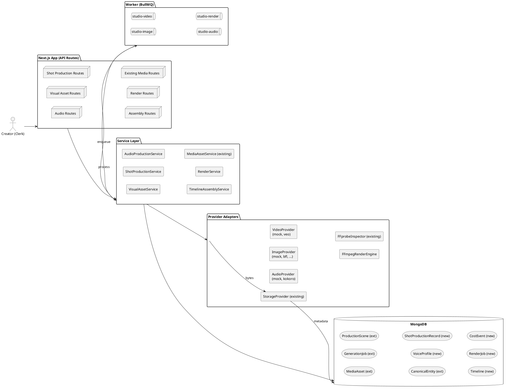

**Call frequencies**: API→Service is on-demand (user action). Service→Worker enqueue is
one per generation request. Worker→Provider is the long-tail (seconds to minutes for
images; minutes for video; poll loop 10–60s). Worker→DB is read-heavy during polling,
write-once on completion.

### 2.1.2 Service/Component Overall Architecture

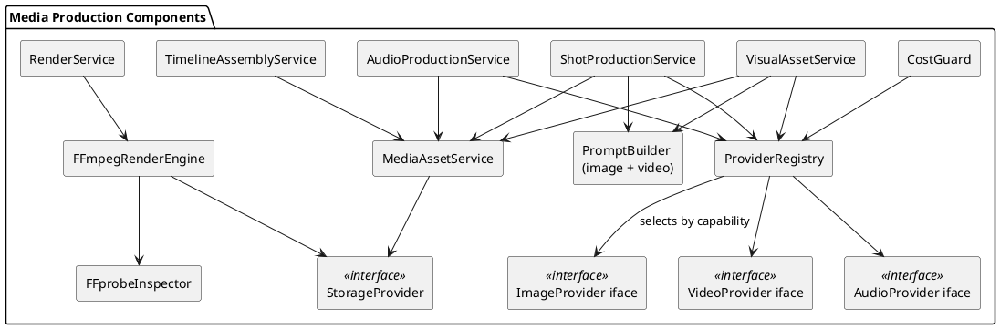

**Module responsibilities**:
- `ProviderRegistry` — holds adapter instances keyed by id; selects an eligible provider by
  (capability, enabled-flag, api-key-present, cost-limit). Never falls back from free to paid (MP-I-010, D-011).
- `PromptBuilder` — pure functions that assemble typed prompt objects from shot + references + style. No provider calls.
- `CostGuard` — pre-submit check against `Project.costLimitCents` and accumulated `CostEvent` totals; rejects with `cost_limit_exceeded` (MP-J-008).
- Services own business rules and stage transitions; they delegate I/O to repositories and external calls to provider adapters.

**Configuration strategy**: Provider selection is env-driven (`IMAGE_PROVIDER`, `VIDEO_PROVIDER`,
`AUDIO_PROVIDER`). When unset or no API key is present, the registry returns the mock adapter
(MP-C-005, D-013, J-002, J-007). Paid adapters throw at construction if their key is missing
rather than at call time (MP-C-008, D-014, J-022).

### 2.1.3 Implementation Design

#### Visual Asset Lifecycle State Machine (MP-A-013, A-014, F-006, F-007, J-011, J-013)

The pre-asset states live on the GenerationJob; the post-asset states live on MediaAsset.reviewStatus.

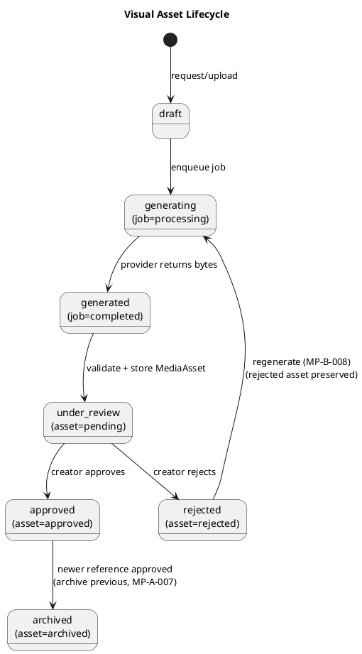

#### Shot Production Flow (MP-B-001 – B-010)

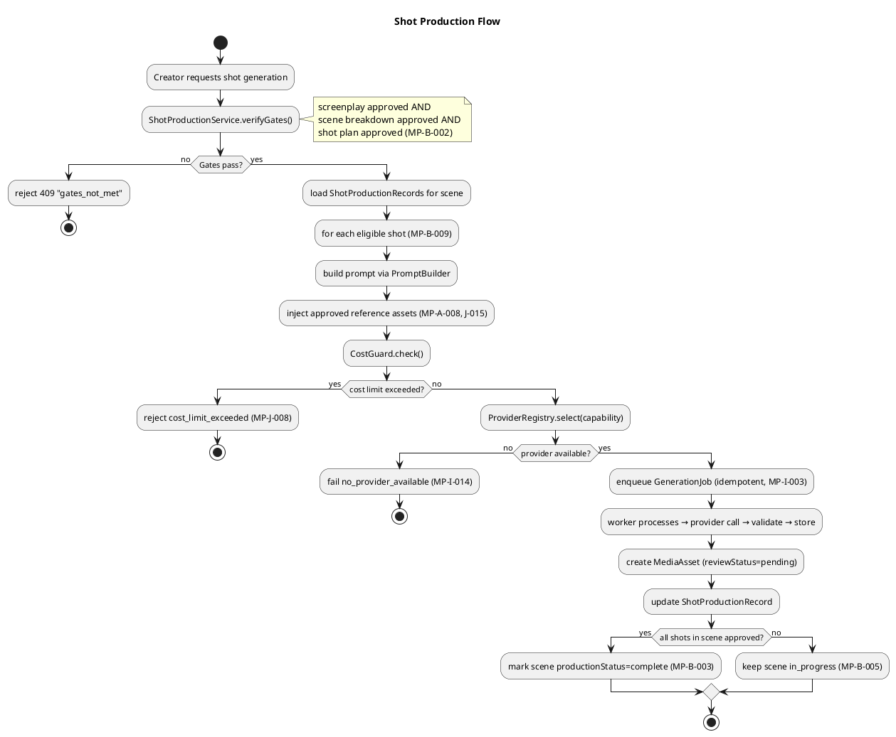

#### Render Job Lifecycle (MP-H-001 – H-015)

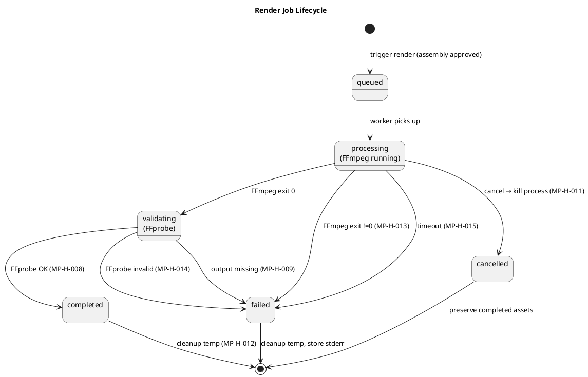

## 2.2 Interface Design

### 2.2.1 Overall Design

All new interfaces are TypeScript types/interfaces in `lib/providers/media/` and `lib/services/`.
They follow the existing pattern: dependency-injected, `"server-only"` imports, no `any` types.

| Interface | Location | Stability | Purpose |
|---------|---------|---------|---------|
| `ImageProvider` | `lib/providers/media/image/types.ts` | Stable | Image generation (sync return) |
| `VideoProvider` | `lib/providers/media/video/types.ts` | Stable | Async video generation lifecycle |
| `AudioProvider` | `lib/providers/media/audio/types.ts` | Stable | Dialogue/SFX/music generation |
| `ProviderCapability` | `lib/providers/media/capability.ts` | Stable | Static capability declaration |
| `ProviderRegistry` | `lib/providers/media/registry.ts` | Stable | Provider selection by capability |
| `FFmpegRenderEngine` | `lib/providers/media/ffmpeg/engine.ts` | Stable | Render command construction + execution |
| `RenderPreset` | `lib/providers/media/ffmpeg/presets.ts` | Stable | Static preset registry |
| `ImagePromptBuilder` | `lib/providers/media/prompt/image.ts` | Stable | Structured image prompt assembly |
| `VideoPromptBuilder` | `lib/providers/media/prompt/video.ts` | Stable | Motion-aware video prompt assembly |
| `CostGuard` | `lib/services/costGuard.ts` | Stable | Pre-submit cost-limit enforcement |
| `VisualAssetService` | `lib/services/visualAssetService.ts` | Stable | Reference asset orchestration |
| `ShotProductionService` | `lib/services/shotProductionService.ts` | Stable | Shot generation orchestration |
| `AudioProductionService` | `lib/services/audioProductionService.ts` | Stable | Audio generation orchestration |
| `TimelineAssemblyService` | `lib/services/timelineAssemblyService.ts` | Stable | Timeline auto-gen + validation |
| `RenderService` | `lib/services/renderService.ts` | Stable | Render job orchestration |

**Version strategy**: Interfaces are additive. New capabilities are opt-in fields on
`ProviderCapability` with safe defaults. No existing method signature is narrowed.

### 2.2.2 Interface List

#### ImageProvider

```typescript
type ImageGenerationRequest = {
  prompt: ImagePrompt;                 // structured, from ImagePromptBuilder
  referenceImages: StoredReference[];  // approved refs (MP-A-008); empty = text-to-image
  model: string;                       // exact model; never substituted (MP-D-012, I-011)
  settings: { aspectRatio: AspectRatio; seed?: number };
  idempotencyKey: string;
};

type ImageGenerationResult = {
  bytes: Uint8Array;
  mimeType: "image/png" | "image/jpeg" | "image/webp";
  mock: boolean;                       // true → never marked real (MP-C-006)
  referencesUsed: boolean;             // false if fell back to text-to-image (MP-C-004)
  usage?: { estimatedCostCents?: number };
};

interface ImageProvider {
  readonly id: string;
  readonly capabilities: ProviderCapability;
  generate(request: ImageGenerationRequest): Promise<ImageGenerationResult>;
}
```
- **Preconditions**: `request.model` must equal a model this provider supports; registry guarantees this.
- **Postconditions**: returns validated image bytes; `mock` flag distinguishes mock output.
- **Exception mapping**: `content_rejected` (non-retryable), `invalid_media` (non-retryable), `provider_transient` (retryable), `no_provider_available` (non-retryable).

#### VideoProvider

```typescript
type VideoGenerationRequest = {
  prompt: VideoPrompt;
  referenceImage?: StoredReference;    // image-to-video when supported
  model: string;
  settings: { aspectRatio: AspectRatio; durationSeconds: number };
  idempotencyKey: string;
};

type VideoOperationHandle = {
  operationId: string;                 // provider async op id (MP-D-008)
  status: "submitted";
};

type VideoPollResult =
  | { status: "processing" }
  | { status: "completed"; bytes: Uint8Array; mimeType: "video/mp4" | "video/webm"; mock: boolean; usage?: { estimatedCostCents?: number } }
  | { status: "failed"; code: "content_rejected" | "provider_transient"; };

interface VideoProvider {
  readonly id: string;
  readonly capabilities: ProviderCapability;
  submit(request: VideoGenerationRequest): Promise<VideoOperationHandle>;
  poll(handle: VideoOperationHandle): Promise<VideoPollResult>;
  cancel?(handle: VideoOperationHandle): Promise<void>;
}
```
- **Preconditions**: `capabilities.supportsImageToVideo === true` if `referenceImage` supplied (MP-D-004).
- **Postconditions**: `poll` returns `completed` only with valid video bytes; worker validates via FFprobe before storing (MP-D-015).
- **Polling contract**: caller polls at 10–60s intervals (MP-D-007); provider never blocks.

#### AudioProvider

```typescript
type AudioGenerationRequest = {
  kind: "dialogue" | "narration" | "sfx";
  text: string;                        // screenplay dialogue line (MP-E-004) or SFX description
  voiceProfile?: VoiceProfileRecord;   // required for dialogue (MP-E-003)
  settings: { language: string; };
  idempotencyKey: string;
};

type AudioGenerationResult = {
  bytes: Uint8Array;
  mimeType: "audio/wav" | "audio/mpeg";
  mock: boolean;
  usage?: { estimatedCostCents?: number };
};

interface AudioProvider {
  readonly id: string;
  readonly capabilities: ProviderCapability;
  generate(request: AudioGenerationRequest): Promise<AudioGenerationResult>;
}
```
- **Preconditions**: for `kind: "dialogue"`, `voiceProfile` must be present and approved (MP-E-003). `text` must originate from the approved screenplay (MP-E-004, E-005).
- **Postconditions**: bytes validated via FFprobe (MP-E-010) before MediaAsset creation.

#### ProviderCapability (static declaration)

```typescript
type ProviderCapability = {
  supportsImageToImage: boolean;
  supportsImageToVideo: boolean;
  supportsReferenceGuidedVideo: boolean;
  maxClipDurationSeconds: number;      // drives shot splitting (MP-B-011, D-010)
  maxImageDimension: number;
  isMock: boolean;                     // true → output marked mock, never real (MP-C-006, J-002)
  isPaid: boolean;                     // true → requires explicit enable + creator action (MP-J-006)
  supportedModels: readonly string[];
};
```
- Queried statically — never via test API call (MP-D-003). Each adapter exports a `capabilities` constant.

#### FFmpegRenderEngine

```typescript
type RenderPlan = {
  timeline: TimelineRecord;
  preset: RenderPreset;
  inputAssets: MediaAssetRecord[];     // resolved + ownership-checked
  workDir: string;                     // temp, cleaned on terminal state (MP-H-012)
};

type RenderResult = {
  bytes: Uint8Array;
  mimeType: "video/mp4";
  ffmpegVersion: string;
  renderDurationSeconds: number;
};

interface FFmpegRenderEngine {
  render(plan: RenderPlan, signal: AbortSignal): Promise<RenderResult>;
}
```
- **Preconditions**: `FFMPEG_PATH` configured (else `ffmpeg_not_configured`, MP-H-002). All input assets exist and are ownership-checked. Assembly plan approved (MP-G-010).
- **Postconditions**: output validated via `FFprobeMediaInspector` before return (MP-H-008). FFmpeg invoked via `execFile` with argument array — no shell string (MP-H-010). `AbortSignal` cancels and kills the process for that job only (MP-H-011).
- **Exception mapping**: `render_timeout` (MP-H-015), `render_output_invalid` (MP-H-014), `ffmpeg_not_configured` (MP-H-002), `ffmpeg_nonzero_exit` (MP-H-013).

#### RenderPreset (static registry)

```typescript
type RenderPreset = {
  id: "vertical_9_16" | "landscape_16_9" | "square_1_1";
  aspectRatio: AspectRatio;
  width: number;
  height: number;
  frameRate: number;
  videoCodec: "libx264";
  pixelFormat: "yuv420p";
};
```
- Three presets declared as constants (MP-H-004). Per-project override of resolution/fps is stored on the `Timeline` render settings, not a new model.

## 2.3 Data Model

### 2.3.1 Design Goals

1. **Reuse-first**: extend `MediaAsset`, `GenerationJob`, `ProductionScene`, `CanonicalEntity`, `Episode` rather than create parallel models (MP-J-017).
2. **Smallest coherent set**: only 5 new top-level collections (`VoiceProfile`, `ShotProductionRecord`, `Timeline`, `RenderJob`, `CostEvent`). Visual profiles and timeline tracks/clips are embedded subdocuments, not separate collections.
3. **Type safety**: every new schema has a co-located Zod validator (matching the existing `validation/*.ts` pattern) and a typed `*Record` type. No `any`.
4. **Ownership + idempotency**: every model carries `clerkUserId` + `projectId` and a unique `idempotencyKey` where duplicate prevention is required (MP-I-003, I-013).
5. **Queryability**: indexes on `(clerkUserId, projectId, ...)` for list views and on status fields for worker reconciliation.
6. **No breaking migration**: all new fields are nullable/defaulted; existing documents remain valid.

### 2.3.2 Model Implementation

#### New Models

**1. VoiceProfile** (`lib/models/voiceProfile.ts`)

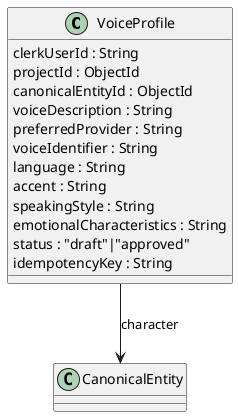
- Linked to a character `CanonicalEntity` (entityType=character). One approved profile per character (MP-E-002). Used to maintain voice consistency across episodes.

**2. ShotProductionRecord** (`lib/models/shotProductionRecord.ts`)

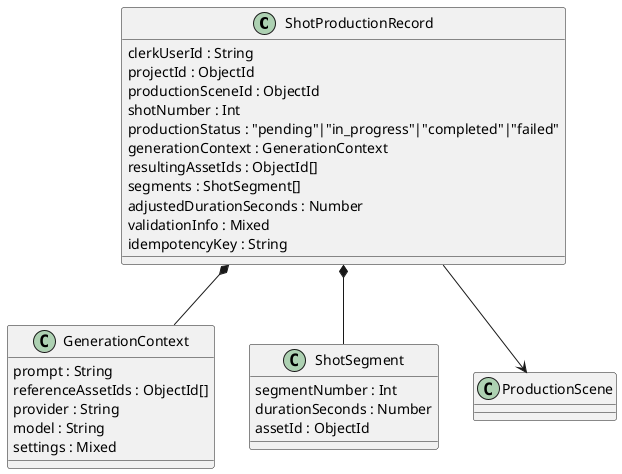
- One record per shot in an approved shot plan (MP-B-001). `segments` supports duration splitting (MP-B-011, D-010). `adjustedDurationSeconds` records provider-limit adjustments without silently changing scene duration (MP-B-012). Regeneration creates a new record and preserves the rejected asset (MP-B-008, B-010).

**3. Timeline** (`lib/models/timeline.ts`) — with embedded tracks/clips

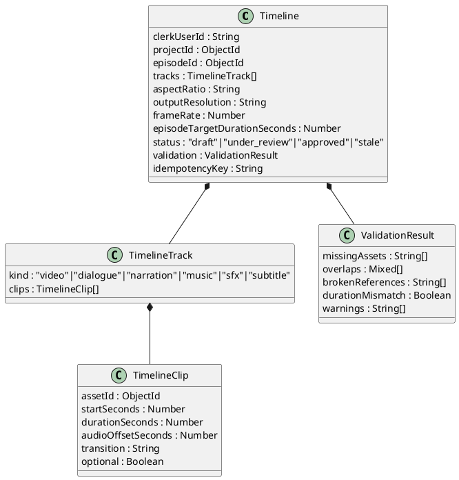
- Auto-generated from approved scene/shot order + actual video durations (MP-G-002, G-003). `validation` carries missing-media, overlap, broken-reference, and duration-mismatch findings (MP-G-004–G-008, G-011). Optional assets (e.g., background music) don't block render (MP-G-006). Approval gate: `status` must be `approved` before rendering (MP-G-010).

**4. RenderJob** (`lib/models/renderJob.ts`)

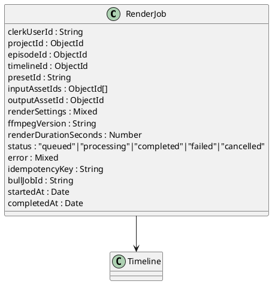
- Records input assets + render settings on enqueue (MP-H-006), output asset + ffmpeg version + duration on completion (MP-H-007). Reuses `render.final` job type; this model is the render-specific record alongside the generic `GenerationJob`.

**5. CostEvent** (`lib/models/costEvent.ts`)

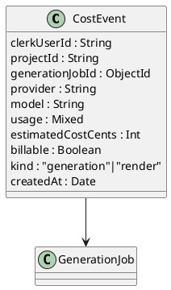
- One per job completion/failure/cancel (MP-J-003, J-004). `billable: false` on failure/cancel. Aggregated by `CostGuard` for pre-submit limit checks (MP-J-008).

#### Static Registries (no persistence)

- **ProviderCapability**: declared as a typed constant on each adapter (see §2.2.2). No DB model — capabilities are code-coupled to adapters (MP-D-003).
- **RenderPreset**: three constants (`vertical_9_16`, `landscape_16_9`, `square_1_1`) in `lib/providers/media/ffmpeg/presets.ts` (MP-H-004). Per-project resolution/fps override lives on `Timeline.renderSettings`.

#### Existing Model Modifications

**CanonicalEntity** (`lib/models/canonicalEntity.ts`)
- Add `"object"` to `entityType` enum (MP-A-012).
- Add embedded `visualProfile` subdocument (discriminated by entityType): character → appearance/hair/clothing/facial/distinguishing/bodyType/voiceNotes/continuityNotes/defaultPresentation; location → geography/architecture/materials/colourPalette/lighting/weather/atmosphere/continuityNotes; object → description/materials/colourPalette/continuityNotes (MP-A-001, A-009, A-012).
- Add `defaultReferenceAssetId: ObjectId | null` (MP-A-005, J-015).
- Add `voiceProfileId: ObjectId | null` convenience ref (MP-E-002).

**MediaAsset** (`lib/models/mediaAsset.ts`)
- Extend `MEDIA_REVIEW_STATUSES` to `["pending","approved","rejected","archived"]` (MP-A-013, F-006).
- Add `previousVersionId: ObjectId | null` and `replacedById: ObjectId | null` for version history (MP-F-007, J-013).
- Add `canonicalEntityId: ObjectId | null` to associate reference assets with a character/environment/object (MP-A-002, A-003).
- Add index `{ clerkUserId, canonicalEntityId, type, reviewStatus }`.

**GenerationJob** (`lib/models/generationJob.ts`)
- Append new job types to `JOB_TYPES` (no removal/reorder, MP-J-020): `image.character_reference`, `image.environment_reference`, `image.object_reference`, `image.shot`, `video.shot`, `audio.dialogue`, `audio.narration`, `audio.sfx`, `audio.music`, `media.validate`, `assembly.generate`.
- Add `failureClassification: "transient"|"permanent"|null` (MP-I-006, I-008).
- Add `costEventId: ObjectId | null` (MP-J-003).

**ProductionScene** (`lib/models/productionScene.ts`)
- Add `productionStatus: "pending"|"in_progress"|"complete"` (MP-B-003–B-005).
- Add `approvedAt: Date | null` (shot-plan approval timestamp, MP-B-002).

**Episode** (`lib/models/episode.ts`)
- Add `timelineId: ObjectId | null` (MP-G-002).
- Add `renderAssetId: ObjectId | null` (final render output, MP-H-007).

**Project** (`lib/models/project.ts`)
- Add `costLimitCents: Number | null` (MP-J-008). Nullable → no limit.

#### Indexes & Relationships Summary

| Model | New Index | Purpose |
|---------|---------|---------|
| VoiceProfile | `{ clerkUserId, canonicalEntityId, status }` unique partial (status=approved) | One approved voice per character (MP-E-002) |
| ShotProductionRecord | `{ clerkUserId, productionSceneId, shotNumber }` | Per-shot lookup |
| ShotProductionRecord | `{ clerkUserId, projectId, productionStatus }` | Worker reconciliation |
| Timeline | `{ clerkUserId, episodeId }` unique | One timeline per episode |
| Timeline | `{ clerkUserId, projectId, status }` | List + approval gate |
| RenderJob | `{ clerkUserId, timelineId }` | Render history per timeline |
| RenderJob | `{ clerkUserId, status }` | Worker reconciliation |
| CostEvent | `{ clerkUserId, projectId, createdAt }` | Aggregation for cost limit |
| CostEvent | `{ generationJobId }` | Per-job cost lookup |
| MediaAsset (ext) | `{ clerkUserId, canonicalEntityId, type, reviewStatus }` | Canon reference lookup (MP-A-004, J-015) |
| GenerationJob (ext) | `{ clerkUserId, projectId, jobType, status }` | Job listing + duplicate prevention |

**Relationship rules**: All references are ObjectId + `clerkUserId` co-indexed so ownership
checks are always compound. No cross-project references. Deletion of an asset referenced by
an approved episode/render is rejected with dependency list (MP-F-008).

## 2.4 Provider Abstraction Design

All provider-specific code lives behind adapters in `lib/providers/media/`. The production
engine depends only on the interfaces (MP-C-001, C-002, D-001, D-002). Adding a provider
requires a new adapter file + one registry entry — no service changes.

### 2.4.1 Adapter Directory Layout

```
lib/providers/media/
  capability.ts            # ProviderCapability type
  registry.ts              # ProviderRegistry: select by capability + enabled + key-present
  image/
    types.ts               # ImageProvider interface
    mock.ts                # MockImageProvider (MP-C-005, C-006)
    bfl.ts                 # BFL adapter (guarded by IMAGE_PROVIDER_API_KEY)
  video/
    types.ts               # VideoProvider interface
    mock.ts                # MockVideoProvider (MP-D-013)
    veo.ts                 # Veo adapter structure (MP-D-008)
  audio/
    types.ts               # AudioProvider interface
    mock.ts                # MockAudioProvider
    kokoro.ts              # Kokoro adapter (guarded)
  ffmpeg/
    engine.ts              # FFmpegRenderEngine
    presets.ts             # RenderPreset constants
    commandBuilder.ts      # argument-array construction (MP-H-010)
  prompt/
    image.ts               # ImagePromptBuilder
    video.ts               # VideoPromptBuilder
```

### 2.4.2 Mock Adapters (always available)

`MockImageProvider`, `MockVideoProvider`, `MockAudioProvider`:
- `capabilities.isMock = true`, `isPaid = false`.
- Return deterministic placeholder bytes (a tiny valid PNG/MP4/WAV generated in-memory).
- `mock: true` on every result → downstream `readStoredVideoEvidence` and review gates
  reject mock output as real media (MP-C-006, D-013, J-002). The asset is still stored for
  preview but never satisfies a readiness/canon gate.
- Selected automatically when no provider is configured or no API key is present (MP-C-005,
  J-007). Used exclusively in automated tests (MP-D-013, J-005).

### 2.4.3 Commercial Adapter Pattern (BFL image, Kokoro audio)

- Constructor reads its API key from a server-only env var. If absent, construction throws
  `provider_not_configured` — the registry catches this and falls back to mock (MP-C-008,
  D-014). The key never appears in responses, job records, or error messages (MP-J-022).
- `isPaid = true`. The registry never selects a paid provider unless a creator action
  explicitly initiated the job AND the provider is enabled (MP-J-006, J-001, J-009).
- No automatic free→paid failover (MP-D-011, I-010). If the selected provider fails, the
  job fails.

### 2.4.4 Veo Video Adapter Structure (MP-D-008)

`VeoVideoProvider` implements the async `VideoProvider` lifecycle:
1. **submit** → POST to Veo long-running operation endpoint; store `operationId` on the
   GenerationJob `output` field. Return `{ status: "submitted", operationId }`.
2. **poll** → GET operation status. The worker calls `poll` at 10–60s intervals (MP-D-007).
   - `processing` → no-op, reschedule.
   - `completed` → download result URI → return bytes.
   - `failed` → map content-policy rejection to `content_rejected` (non-retryable, MP-D-016).
3. **cancel** → best-effort cancel operation; the worker kills the polling loop and sets
   job `cancelled` (MP-I-015).
4. **Timeout handling** → if polling exceeds a per-job deadline, mark `failed` with
   `render_timeout`-style code (MP-D-008 failure/timeout handling).
- `capabilities.supportsImageToVideo = true`, `supportsReferenceGuidedVideo = true`,
  `maxClipDurationSeconds` declared per Veo model. When a shot duration exceeds this, the
  ShotProductionService splits into segments (MP-B-011, D-010).

### 2.4.5 ProviderRegistry Selection Algorithm

```
select(kind, requiredCapability, model, isCreatorInitiated):
  candidates = adapters[kind] where:
    adapter.capabilities satisfies requiredCapability AND
    adapter is enabled (env flag) AND
    (adapter.isMock OR adapter api-key present) AND
    (NOT adapter.isPaid OR isCreatorInitiated) AND
    model in adapter.capabilities.supportedModels
  if candidates.empty: throw no_provider_available (MP-I-014)
  prefer non-mock if a real adapter is eligible AND creator initiated paid work
  else prefer mock
  never fall back from a failed free provider to a paid one (MP-I-010, D-011)
```

## 2.5 Prompt Builder Design

Prompt builders are pure functions (no I/O, no provider calls). They assemble a **structured,
typed prompt object** from only the relevant context — never the full Story Bible (MP-C-009).

### 2.5.1 ImagePromptBuilder (`lib/providers/media/prompt/image.ts`)

**Input context selected per shot**:
- Shot description (purpose, framing, action, environment) from the approved `ShotPlan`.
- Approved character reference assets for `charactersPresent` (MP-A-008, J-015) — passed as
  `referenceImages`, not concatenated into text.
- Approved environment reference for the scene location (MP-A-009).
- Approved object references for objects identified in the shot.
- Project `visualStyle` + `aspectRatio` from the Project model.
- Lighting + camera angle from the shot plan.
- Continuity notes from the shot plan + character/environment profiles.

**Output**: `ImagePrompt { subject, environment, style, lighting, camera, composition, continuityNotes }`.
Each field is a bounded string. Total assembled text is capped (e.g., 2000 chars) to avoid
dumping the entire bible. The builder explicitly excludes world rules, themes, boundaries,
and canon facts that are not visually relevant to this shot.

### 2.5.2 VideoPromptBuilder (`lib/providers/media/prompt/video.ts`)

Extends the image prompt with **motion description** (MP-D-009):
- Character motion (e.g., "walking", "turning", "reaching") derived from shot `action`.
- Environmental response (e.g., "rain falling", "curtains swaying") from environment + weather.
- Camera movement (e.g., "slow dolly forward", "static wide") from `cameraDirection`.
- Duration intent and any segment continuity note when the shot was split (MP-B-011).

**Output**: `VideoPrompt { staticScene: ImagePrompt, motion, cameraMovement, durationSeconds, segmentNote }`.

**Reuse**: Both builders read from existing `ProductionScene` + `ShotPlan` + `CanonicalEntity`
+ `Project` models — no new narrative data is created or modified (MP-J-010).

## 2.6 Service Layer Design

All services follow the existing pattern: `"server-only"` import, dependency-injected
repositories/ports, `StudioError` for domain errors, `RequestAuth` for ownership.

### 2.6.1 VisualAssetService (`lib/services/visualAssetService.ts`)
- `requestReference(actor, projectId, canonicalEntityId, kind)` — enqueues an
  `image.*_reference` job after verifying the entity is approved (MP-A-001).
- `uploadReference(actor, projectId, canonicalEntityId, bytes, metadata)` — validates via
  `validateMediaBytes`, stores via `MediaAssetService.storeVerified` with `canonicalEntityId`,
  sets `reviewStatus: "pending"` (MP-A-003).
- `approveReference(actor, assetId)` — sets `reviewStatus: "approved"`, designates as
  `defaultReferenceAssetId` on the CanonicalEntity. If a previous approved reference exists,
  archive it (`reviewStatus: "archived"`, set `previousVersionId`/`replacedById`) — MP-A-005,
  A-007, J-011, J-013.
- `rejectReference(actor, assetId)` — sets `reviewStatus: "rejected"` (MP-A-014).
- **Canon guard**: only `approved` references are injected as generation input (MP-A-004, J-012).

### 2.6.2 ShotProductionService (`lib/services/shotProductionService.ts`)
- `createRecordsFromPlan(actor, sceneId)` — creates `ShotProductionRecord` per shot in the
  approved plan (MP-B-001).
- `verifyGates(actor, sceneId)` — checks screenplay + scene breakdown + shot plan all approved
  (MP-B-002).
- `generateShot(actor, shotRecordId)` — single-shot enqueue (MP-B-006).
- `generateScene(actor, sceneId)` — enqueue all eligible shots (MP-B-007).
- `retryScene(actor, sceneId)` — only regenerate failed/rejected/not-yet-generated shots;
  skip approved (MP-B-009).
- `regenerateRejected(actor, shotRecordId)` — new job, preserve rejected asset (MP-B-008, B-010).
- `evaluateSceneCompletion(sceneId)` — if all shots have approved media → `productionStatus: "complete"`
  (MP-B-003); else `in_progress` (MP-B-004, B-005).
- Duration splitting: if shot duration > provider `maxClipDurationSeconds`, create segments
  (MP-B-011); record `adjustedDurationSeconds` without silently changing scene duration (MP-B-012).

### 2.6.3 AudioProductionService (`lib/services/audioProductionService.ts`)
- `generateDialogue(actor, sceneId, shotRecordId)` — loads approved screenplay dialogue lines
  for the speaker (MP-E-004); refuses if no dialogue exists (MP-E-005); applies creator
  text override while preserving original (MP-E-006); requires approved VoiceProfile (MP-E-003).
- `generateSfx(actor, sceneId, description)` — ambient/SFX generation (MP-E-007).
- `addMusic(actor, sceneId, assetId, volume, timing, licensing)` — records association +
  licensing; rejects unlicensed copyrighted music (MP-E-008, E-009).
- `validateAudio(assetId)` — FFprobe validation; flag dialogue duration > shot video duration
  (MP-E-010, E-011, E-012).

### 2.6.4 TimelineAssemblyService (`lib/services/timelineAssemblyService.ts`)
- `autoGenerate(actor, episodeId)` — builds Timeline from approved scene order, shot order,
  **actual** video durations (not estimated, MP-G-003), approved audio, transitions, episode
  duration target (MP-G-002).
- `validate(timelineId)` — checks missing required media (MP-G-004), allows optional missing
  (MP-G-006), detects overlapping clips (MP-G-007), broken references (MP-G-008), duration
  mismatch vs target (MP-G-011). Returns structured `ValidationResult`.
- `preview(actor, episodeId)` — returns the assembly plan for creator review (MP-G-009).
- `approve(actor, timelineId)` — sets `status: "approved"`; rendering cannot start before this
  (MP-G-010).

### 2.6.5 RenderService (`lib/services/renderService.ts`)
- `triggerRender(actor, timelineId, presetId)` — requires `timeline.status === "approved"`
  (MP-G-010); enqueues `render.final` job via existing BullMQ (MP-H-005); creates `RenderJob`
  recording input assets + settings (MP-H-006).
- `recordCompletion(renderJobId, outputAsset, ffmpegVersion, duration)` (MP-H-007).
- `cancel(renderJobId)` — sets `cancelled`, kills FFmpeg process for that job only, preserves
  completed assets (MP-H-011, I-015).
- Concurrency: render queue is already 1 (MP-I-012).

### 2.6.6 CostGuard (`lib/services/costGuard.ts`)
- `check(actor, projectId, estimatedCostCents)` — if `Project.costLimitCents` is set and
  accumulated `CostEvent` total + estimate exceeds it, throw `cost_limit_exceeded` (MP-J-008).
- `record(jobId, provider, model, usage, billable)` — creates `CostEvent` (MP-J-003, J-004).

## 2.7 Worker / Queue Integration Design

### 2.7.1 Job Type → Queue Mapping (extends `queueNameFor`)

| New Job Type | Queue | Concurrency | Rationale |
|---------|---------|---------|---------|
| `image.character_reference` / `image.environment_reference` / `image.object_reference` | studio-image | 2 | Reference images are independent |
| `image.shot` | studio-image | 2 | Shot images are independent |
| `video.shot` | studio-video | 1 | Provider rate limits; keep existing 1 |
| `audio.dialogue` / `audio.narration` / `audio.sfx` / `audio.music` | studio-audio | 2 | Audio is lightweight |
| `media.validate` | studio-llm | 2 | FFprobe is fast, CPU-bound |
| `assembly.generate` | studio-llm | 2 | Pure computation, no external call |
| `render.final` (existing) | studio-render | 1 | Resource contention (MP-I-012) |

Existing `video.scene` and `render.final` remain unchanged for backward compatibility.

### 2.7.2 Idempotency & Duplicate Prevention
- `GenerationJob.idempotencyKey` is unique (existing). New jobs derive keys as
  `${jobType}:${projectId}:${sceneId}:${shotNumber}:${attempt}` — reusing the existing
  `enqueueNew` prefix-lookup logic (MP-I-003).
- Two jobs attempting to overwrite the same approved asset: first to complete wins; second
  is rejected as `media_idempotency_conflict` (existing repository behavior, MP-I-013).

### 2.7.3 Retry Policy & Failure Classification
- BullMQ `attempts: 3`, exponential backoff (existing, MP-I-005).
- `failureClassification` set from an error-code map:
  - **Permanent (no auto-retry)**: `invalid_media`, `invalid_video`, `content_rejected`,
    `cost_limit_exceeded`, `ownership`, `no_provider_available`, `unknown_model`,
    `safety_rejection` (MP-I-006, C-012, D-016).
  - **Transient (retry up to 3)**: `provider_transient`, `timeout`, `storage_transient`.
- On retry, already-completed assets in the same run are not regenerated (MP-I-004) — the
  ShotProductionRecord tracks per-shot state, so retry resumes only incomplete shots.

### 2.7.4 Canon Protection in the Worker
- Before enqueuing, the worker/service verifies the asset's `reviewStatus === "approved"`;
  rejected/draft/pending assets are excluded from prompts and timelines (MP-J-012).
- Approved references are injected as generation input (MP-A-008, J-015).
- Narrative models are read-only: the worker never writes to Story, StoryBible, SeasonPlan,
  or ContinuityLedger (MP-J-010).
- If an approved shot plan is modified after media generation, `ShotProductionService`
  identifies affected `ShotProductionRecord`s and marks them `stale` for re-evaluation
  (MP-J-014, J-016).

### 2.7.5 Reconciliation (existing, extended)
- `reconcileOpenJobs` already re-enqueues `queued`/`processing` jobs under the attempt limit
  on worker restart (MP-I-007). New job types are covered automatically because they share
  the `GenerationJob` collection and status enums.

## 2.8 FFmpeg Rendering Engine Design

### 2.8.1 Command Construction (`commandBuilder.ts`)
- Builds an **argument array**, never a shell string (MP-H-010). Invoked via `execFile`
  (matching the existing `FFprobeMediaInspector` pattern).
- Pipeline stages, each as array segments:
  1. **Input concat** — list of input asset storage keys downloaded to `workDir`; ordered by
     timeline clip `startSeconds`. Uses `-f concat -safe 0` with a generated concat demuxer
     file (paths are sanitized temp filenames, never user text).
  2. **Dimension normalization** — scale all clips to preset `width×height` with
     `scale=` + `setsar=1` to fix aspect ratio (MP-H-001).
  3. **Frame-rate normalization** — `fps=preset.frameRate` (MP-H-001).
  4. **Codec handling** — `-c:v libx264 -pix_fmt yuv420p` (broad compatibility); audio
     `-c:a aac` (MP-H-001).
  5. **Audio mixing** — dialogue + narration + music + sfx tracks mixed via `amix` with
     per-track volume from `TimelineClip` settings; music ducked under dialogue (MP-H-001).
  6. **Subtitle rendering** — burn-in via `subtitles=` filter from approved subtitle asset
     (MP-H-001). Subtitle file written to `workDir` (sanitized).
  7. **Transitions** — simple crossfade (`xfade`) between clips where `transition` is set.
  8. **Output** — `-preset fast -movflags +faststart` to `workDir/output.mp4`.

### 2.8.2 Presets (`presets.ts`)
| Preset | Aspect | Resolution | FPS |
|---------|---------|---------|---------|
| `vertical_9_16` | 9:16 | 1080×1920 | 30 (MP-H-003) |
| `landscape_16_9` | 16:9 | 1920×1080 | 30 |
| `square_1_1` | 1:1 | 1080×1080 | 30 |

Configurable per-project override of resolution/fps stored on `Timeline.renderSettings`.

### 2.8.3 Execution & Validation Flow
1. Download all input assets from `StorageProvider` to `workDir` (ownership-checked).
2. Verify each input via `FFprobeMediaInspector` — reject if any is invalid (MP-F-014).
3. Construct argument array; invoke `execFile(FFMPEG_PATH, args, { timeout, signal })`.
4. On exit 0: validate output via `FFprobeMediaInspector` (MP-H-008). If output missing or
   invalid → `render_output_invalid` (MP-H-009, H-014).
5. On non-zero exit: truncate stderr to ≤4KB, store on `RenderJob.error`, mark failed
   (MP-H-013).
6. On timeout (AbortSignal/timeout): kill process, mark `render_timeout` (MP-H-015).
7. **Always** (terminal `finally`): delete `workDir` recursively (MP-H-012).
8. Cancel: `AbortController.abort()` kills only this job's process (MP-H-011).

### 2.8.4 Guard
- If `FFMPEG_PATH` env is unset, `FFmpegRenderEngine` throws `ffmpeg_not_configured` before
  any work (MP-H-002). The render queue handler catches this and marks the job failed
  without retry.

## 2.9 API Route Design

All routes follow the existing pattern: `logged(request, async () => { const actor = await readActor(); ... return jsonData({...}); })`,
Zod-validated input, ownership via `actor.userId`, `StudioError` for domain errors. No raw
`storageKey` or filesystem path is ever returned (MP-F-015).

### 2.9.1 Visual Asset Routes
| Method | Path | Purpose | Req ref |
|---------|---------|---------|---------|
| POST | `/api/projects/[projectId]/visual-assets/characters/[entityId]/reference` | Request/upload character reference (MP-A-002, A-003) | |
| POST | `/api/projects/[projectId]/visual-assets/environments/[entityId]/reference` | Environment reference (MP-A-009, A-010) | |
| POST | `/api/projects/[projectId]/visual-assets/objects` | Create object profile (MP-A-012) | |
| PATCH | `/api/projects/[projectId]/media/[assetId]/review` | Approve/reject (MP-A-005, A-014) | |
| GET | `/api/projects/[projectId]/visual-assets` | List visual profiles + references | |

### 2.9.2 Shot Production Routes
| Method | Path | Purpose | Req ref |
|---------|---------|---------|---------|
| POST | `/api/projects/[projectId]/scenes/[sceneId]/shots/generate` | Generate all eligible shots (MP-B-007) | |
| POST | `/api/projects/[projectId]/scenes/[sceneId]/shots/[shotId]/generate` | Single shot (MP-B-006) | |
| POST | `/api/projects/[projectId]/scenes/[sceneId]/retry` | Retry failed/rejected only (MP-B-009) | |
| GET | `/api/projects/[projectId]/scenes/[sceneId]/shots` | List ShotProductionRecords | |

### 2.9.3 Audio Routes
| Method | Path | Purpose | Req ref |
|---------|---------|---------|---------|
| POST | `/api/projects/[projectId]/scenes/[sceneId]/audio/dialogue` | Generate dialogue (MP-E-004) | |
| POST | `/api/projects/[projectId]/scenes/[sceneId]/audio/sfx` | Generate SFX (MP-E-007) | |
| POST | `/api/projects/[projectId]/scenes/[sceneId]/audio/music` | Add music + licensing (MP-E-008, E-009) | |
| POST | `/api/projects/[projectId]/characters/[entityId]/voice-profile` | Create/update voice profile (MP-E-001) | |

### 2.9.4 Assembly Routes
| Method | Path | Purpose | Req ref |
|---------|---------|---------|---------|
| POST | `/api/projects/[projectId]/episodes/[episodeId]/assembly` | Auto-generate + validate timeline (MP-G-002) | |
| GET | `/api/projects/[projectId]/episodes/[episodeId]/assembly` | Preview assembly plan (MP-G-009) | |
| POST | `/api/projects/[projectId]/episodes/[episodeId]/assembly/approve` | Approve assembly (MP-G-010) | |

### 2.9.5 Render Routes
| Method | Path | Purpose | Req ref |
|---------|---------|---------|---------|
| POST | `/api/projects/[projectId]/episodes/[episodeId]/render` | Trigger render (MP-H-005) | |
| GET | `/api/projects/[projectId]/episodes/[episodeId]/render` | Render status (MP-H-006, H-007) | |
| POST | `/api/projects/[projectId]/render/[renderJobId]/cancel` | Cancel render (MP-H-011) | |

### 2.9.6 Cost/Provider Routes (admin)
| Method | Path | Purpose | Req ref |
|---------|---------|---------|---------|
| GET | `/api/projects/[projectId]/cost` | Cost summary (MP-J-003) | |

All existing routes (`/api/projects/[projectId]/media/*`, `/api/generations/*`) remain
unchanged. New media assets are listed through the existing media route.

## 2.10 UI Workspace Design

Five new workspace pages under `app/(studio)/projects/[projectId]/`, reusing the existing
`StageLayout` component and `useProject` hook. **Styling: CSS Modules** — each page gets a
co-located `*.module.css`. No Tailwind utility classes are introduced in new pages (the
existing `globals.css` `.studio-field` etc. classes are reused for form controls).

| Workspace | Page Path | Component | Purpose |
|---------|---------|---------|---------|
| Visual Assets | `visual-assets/page.tsx` | `VisualAssetsPanel` | Character/env/object profiles + reference images, approve/reject (Phase A) |
| Shot Production | `shots/page.tsx` | `ShotProductionPanel` | Per-shot status, generate/retry, preview media (Phase B–D) |
| Audio | `audio/page.tsx` | `AudioPanel` | Voice profiles, dialogue/SFX/music, duration mismatch flags (Phase E) |
| Assembly | `assembly/page.tsx` | `AssemblyPanel` | Timeline preview, validation findings, approve gate (Phase G) |
| Rendering | `rendering/page.tsx` | `RenderingPanel` | Preset select, trigger render, progress, cancel, download (Phase H) |

**Structure**: Each panel is a client component (`"use client"`) using SWR/fetch hooks to
poll job status (reusing existing hook patterns). CSS Modules scope layout; the existing
dark-theme CSS variables (`--background`, `--foreground`) and `.studio-field` class are
reused for visual consistency. No new global CSS is added.

**Non-goal**: A large nonlinear video editor is not built (per constraints). The Assembly
workspace shows a read-only timeline preview with validation findings and an approve
button — not a frame-level editor.

## 2.11 Security Boundaries

| Concern | Control | Req ref |
|---------|---------|---------|
| API keys in client bundles | Keys read in `"server-only"` modules only; never in `NEXT_PUBLIC_*`; adapters constructed server-side | MP-J-022 |
| Keys in responses/errors | `safeErrorMessage` redacts connection strings; adapter errors throw codes, not keys | MP-J-022 |
| Path traversal in storage | Existing `safePath` rejects `..`, `\`, absolute, non-`[A-Za-z0-9._-]` keys; storage keys are system-derived hashes, never user-supplied | MP-F-010, F-011 |
| Upload validation | `validateMediaBytes` checks magic-byte signature, MIME, per-type size limit before any storage write | MP-A-003, C-012 |
| Arbitrary shell execution | FFmpeg/FFprobe invoked via `execFile` with argument arrays; no `exec`/shell string; user text never interpolated into args | MP-H-010 |
| Ownership checks | Every route + repository query compounds `clerkUserId`; `readActor()` enforces auth; `ownsProject`/`findOwned` everywhere | MP-J-021, F-015 |
| Media download auth | `openOwned` checks ownership + `storageVerified` + `storage.stat` before streaming; raw keys never exposed | MP-F-014, F-015 |
| Paid API gating | Registry never selects paid adapter without creator action + explicit enable + key present; tests use mock exclusively | MP-J-005, J-006, D-013, D-014 |
| Cost limits | `CostGuard` pre-check rejects before provider call | MP-J-008 |
| Deletion of referenced assets | Reject deletion if asset referenced by approved episode/render; report dependencies | MP-F-008 |
| Canon integrity | Worker never writes to narrative models; only `approved` assets enter prompts/timelines | MP-J-010, J-012 |

## 2.12 Migration / Schema-Change Plan

All changes are **additive and backward-compatible**. No existing field is removed or
reordered. Existing documents remain valid because every new field is nullable or has a
default.

### 2.12.1 Schema Changes (applied via existing Mongoose model definitions — no separate migration script needed)

1. **CanonicalEntity**: add `"object"` to `entityType` enum; add `visualProfile` embedded
   subdoc (default `{}`); add `defaultReferenceAssetId` (default `null`); add `voiceProfileId`
   (default `null`).
2. **MediaAsset**: add `"archived"` to `MEDIA_REVIEW_STATUSES`; add `previousVersionId`,
   `replacedById`, `canonicalEntityId` (all default `null`); add index.
3. **GenerationJob**: append 11 new values to `JOB_TYPES` const (no reorder); add
   `failureClassification` (default `null`); add `costEventId` (default `null`).
4. **ProductionScene**: add `productionStatus` (default `"pending"`); add `approvedAt`
   (default `null`).
5. **Episode**: add `timelineId`, `renderAssetId` (default `null`).
6. **Project**: add `costLimitCents` (default `null`).
7. **New collections**: `voiceProfiles`, `shotProductionRecords`, `timelines`, `renderJobs`,
   `costEvents` — created automatically by Mongoose on first write.

### 2.12.2 Backfill
- **No backfill required** for existing projects: new fields default to null/empty, so legacy
  projects simply have no visual profiles, shot records, timelines, or renders until the
  creator initiates media production.
- **Optional one-time script** (`scripts/backfill-scene-production-status.ts`): set
  `ProductionScene.productionStatus = "complete"` for scenes where `videoStatus === "completed"`
  and `videoAssetId` is set, to migrate legacy completed scenes. This is optional and only
  for projects already using the legacy `video.scene` mock path.

### 2.12.3 Index Creation
- New indexes (see §2.3.2) are declared in model files and created by Mongoose
  `autoIndex` (enabled in dev). For production, run `scripts/ensure-indexes.ts` (new) to
  create indexes explicitly without relying on startup-time autoIndex.

## 2.13 Environment Variables

New env vars (added to `.env.example`); all server-side only (no `NEXT_PUBLIC_` prefix).

| Variable | Purpose | Default | Req ref |
|---------|---------|---------|---------|
| `FFMPEG_PATH` | Path to ffmpeg binary; unset → `ffmpeg_not_configured` | (unset) | MP-H-002 |
| `IMAGE_PROVIDER` | `mock\|bfl\|...` | `mock` | MP-C-005 |
| `IMAGE_PROVIDER_API_KEY` | Paid image provider key | (unset) | MP-C-008 |
| `IMAGE_MODEL` | Default image model | (unset) | |
| `VIDEO_PROVIDER` | `mock\|veo\|...` | `mock` | MP-D-013 |
| `VIDEO_PROVIDER_API_KEY` | Paid video provider key | (unset) | MP-D-014 |
| `VIDEO_MODEL` | Default video model | (unset) | MP-D-012 |
| `VIDEO_POLL_INTERVAL_MS` | Async poll interval (clamped 10000–60000) | `15000` | MP-D-007 |
| `VIDEO_OPERATION_TIMEOUT_MS` | Max wait for a video operation | `600000` | MP-D-008 |
| `AUDIO_PROVIDER` | `mock\|kokoro\|...` | `mock` | |
| `AUDIO_PROVIDER_API_KEY` | Paid audio provider key | (unset) | |
| `RENDER_TIMEOUT_MS` | Per-render FFmpeg timeout | `1800000` | MP-H-015 |
| `RENDER_CONCURRENCY` | Override render queue concurrency | `1` | MP-I-012 |
| `COST_LIMIT_DEFAULT_CENTS` | Default per-project cost limit if unset | (unset = unlimited) | MP-J-008 |
| `MEDIA_UPLOAD_MAX_BYTES` | Override upload size ceiling | (uses per-type limits) | |

Existing vars reused: `FFPROBE_PATH`, `MEDIA_STORAGE_PROVIDER`, `MEDIA_LOCAL_STORAGE_DIR`,
`REDIS_URL`, `MONGODB_URI`, Clerk vars. The existing `IMAGE_PROVIDER`/`VIDEO_PROVIDER`/
`AUDIO_PROVIDER` placeholders in `.env.example` are given real adapter implementations.

## 2.14 Implementation Phasing

Aligned with the 6-phase implementation order from the requirements. Each phase is
independently shippable and testable with mock providers.

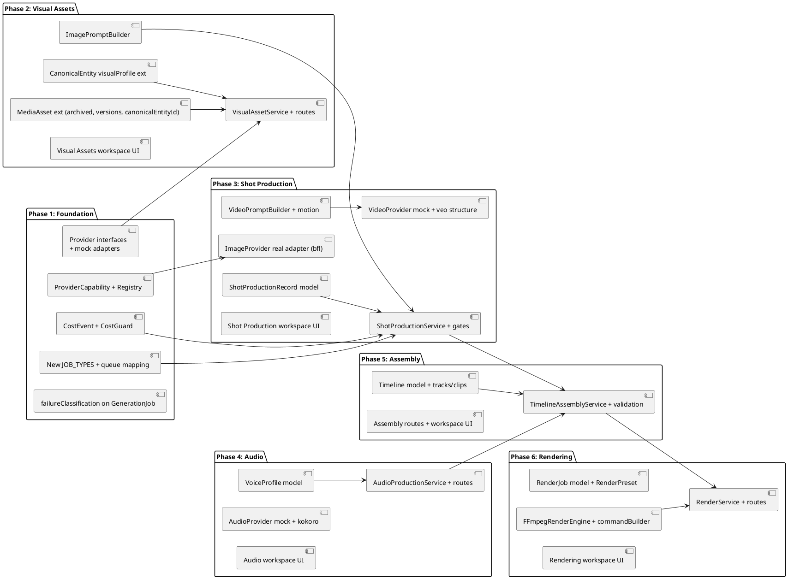

| Phase | Deliverables | Req Phases Covered | Exit Criteria |
|---------|---------|---------|---------|
| 1 — Foundation | Provider interfaces, mock adapters, capability/registry, CostEvent+CostGuard, new JOB_TYPES, failureClassification | I, J (infra) | Mock image/video/audio jobs enqueue + complete + record cost; tests use mock only |
| 2 — Visual Assets | CanonicalEntity visualProfile, MediaAsset extensions, VisualAssetService, ImagePromptBuilder, visual-assets UI | A, C (prompt) | Character/env/object references generated/uploaded, approved, archived with version history |
| 3 — Shot Production | ShotProductionRecord, ShotProductionService, real image adapter, video mock+veo structure, VideoPromptBuilder, shots UI | B, C, D | Shots generated per plan, scene completion gate works, duration splitting works, no silent provider switch |
| 4 — Audio | VoiceProfile, AudioProvider, AudioProductionService, audio UI | E | Dialogue from approved screenplay only, voice consistency, SFX/music + licensing, duration mismatch flags |
| 5 — Assembly | Timeline model, TimelineAssemblyService, validation, assembly UI | G | Auto-generated timeline from actual durations, missing-media/overlap/broken-ref detection, approval gate |
| 6 — Rendering | RenderJob, RenderPreset, FFmpegRenderEngine, RenderService, rendering UI | H | Real FFmpeg render via arg array, FFprobe validation, cancel/cleanup, 3 presets, no shell injection |

**Cross-cutting (every phase)**: security boundaries (§2.11), Clerk ownership, CSS Modules
UI, no paid-API-mandatory, canon protection (read-only narrative models).

---

## Design Decisions Summary

1. **Visual profiles are embedded on CanonicalEntity**, not separate top-level models —
   satisfies MP-J-017 (reuse CanonicalEntity) while adding typed, queryable fields.
2. **VoiceProfile is a separate model** because it must be queried independently across
   episodes for consistency checks (MP-E-002).
3. **ShotProductionRecord is separate from ProductionScene.shotPlan** — the plan is the
   approved intent; the record is the execution state. This preserves the existing plan
   model untouched (MP-J-017).
4. **ProviderCapability and RenderPreset are static declarations, not DB models** — they are
   code-coupled to adapters and queried without API calls (MP-D-003). This keeps the new
   DB model set to 5.
5. **Mock providers are always sufficient** — every phase is testable without paid APIs
   (MP-C-005, D-013, J-005, J-007). Mock output is explicitly flagged and never satisfies
   canon/readiness gates.
6. **No Tailwind introduced** — new UI uses CSS Modules + existing global classes.
7. **No nonlinear editor** — Assembly workspace is a read-only preview + approve gate, not a
   frame editor (per constraints).
8. **FFmpeg uses `execFile` + argument arrays** — reuses the proven FFprobe pattern; no shell
   interpolation (MP-H-010).