# Media Production Pipeline — Requirements Specification

## **1. Component Positioning**

### **1.1 Core Responsibility**
This component is responsible for transforming approved screenplays, scene breakdowns, and shot plans into actual visual and audio media, assembling approved media into ordered film timelines, and rendering finished videos through FFmpeg, achieving a complete AI-assisted film-production workflow from story to exportable film.

### **1.2 Core Inputs**
1. **Approved screenplay and shot plans** from the existing Story and Scene engines, providing scene structure, shot descriptions, character presence, camera instructions, and dialogue.
2. **Approved character visual profiles** from the Character engine, providing physical appearance, facial characteristics, clothing, and reference images for visual consistency.
3. **Approved environment and location profiles** providing geography, architecture, lighting, weather, and reference images for scene continuity.
4. **Creator configuration** selecting media generation providers, models, render presets, and cost constraints.
5. **Creator approval and rejection actions** on generated visual references, shot media, audio assets, assembly plans, and final renders.
6. **Uploaded reference images** for characters, environments, and objects when the creator provides existing visual material.
7. **Worker job trigger signals** from BullMQ for background media generation, validation, assembly, and rendering tasks.

### **1.3 Core Outputs**
1. **Generated media assets** (images, video clips, audio tracks) stored as MediaAsset records with validation metadata, returned for creator review.
2. **Approved production material** (approved shot media, approved audio, approved assembly plans) forming the canon for downstream stages.
3. **Final rendered videos** exported as MediaAsset records of type `final_render`, available for download.
4. **Generation job records** tracking provider, model, settings, status, progress, errors, and cost for every media-generation operation.
5. **Timeline assembly plans** representing the ordered structure of clips, audio tracks, and transitions for a complete film.
6. **Validation results** for every generated media asset, including duration, dimensions, frame rate, codec, and integrity checks.
7. **Cost and usage events** recording provider, model, estimated and actual costs for media generation operations.

### **1.4 Responsibility Boundaries**
- This component is **NOT** responsible for story generation, Story Bible creation, season planning, episode suggestion, CASNA continuity validation, or screenplay writing. Those remain with the existing Story and Character engines.
- This component is **NOT** responsible for LLM-based narrative content creation. It uses LLM output only as input context for prompt building.
- This component is **NOT** responsible for user authentication, project ownership, or admin access control. Those remain with existing auth infrastructure.
- This component is **NOT** responsible for multi-tenant billing, collaborative editing, or SaaS subscription management.
- This component is **NOT** responsible for building a full nonlinear video editor with advanced effects, keyframe animation, or real-time preview scrubbing.
- This component is **NOT** responsible for replacing the existing BullMQ queue system or worker infrastructure.
- This component is **NOT** responsible for re-implementing the MediaAsset model, StorageProvider interface, or FFprobe inspector. These are reused and extended.

---

## **2. Domain Terminology**

**Visual Asset**
: A persistent visual reference for a character, environment, or story object that establishes and maintains visual identity across generated shots and episodes.

**Character Visual Profile**
: A structured record capturing a character's physical appearance, facial characteristics, hair, clothing, distinguishing features, body type, and voice characteristics, used to enforce visual consistency in generated media.

**Environment Visual Profile**
: A structured record capturing a location's geography, architecture, materials, colour palette, lighting, weather, and atmosphere, used to maintain environmental continuity across shots.

**Object Visual Profile**
: A structured record capturing the appearance of an important story object (weapon, document, vehicle, magical item) to preserve its visual identity across shots and episodes.

**Reference Image**
: A MediaAsset of type `character_reference` or `scene_image` that has been approved and designated as the default visual canon for subsequent media generation.

**Shot Production Record**
: An extension of the existing shot plan that adds generation context: image prompt, video prompt, reference assets, generation provider, generation settings, production status, and resulting media assets.

**Image Prompt**
: A structured text description assembled from shot description, approved character visual profiles, approved environment references, camera instructions, and continuity requirements, used as input to an image generation provider.

**Video Prompt**
: A structured text description of the motion and action within a shot clip, assembled from shot action, character identity, environment, camera movement, and continuity requirements, used as input to a video generation provider.

**Provider Capability**
: A declaration of what a specific media generation provider supports, including supported generation modes (text-to-image, image-to-video), maximum durations, supported resolutions, reference image support, and asynchronous operation requirements.

**Generation Request**
: A formal request to a media generation provider containing prompt, reference assets, generation settings, and provider-specific options, tracked as a GenerationJob.

**Voice Profile**
: A persistent record capturing a character's voice characteristics, preferred voice provider, voice identifier, language, accent, and speaking style, used to maintain voice consistency across episodes.

**Timeline**
: An ordered assembly model representing the structure of a complete film, containing video clips, audio tracks, transitions, and subtitles in sequence.

**Timeline Track**
: A layer within a timeline containing ordered clips of a specific type (video, dialogue, narration, music, sound effects).

**Timeline Clip**
: A single media asset placed on a timeline track at a specific start position with a specific duration.

**Render Preset**
: A predefined output configuration specifying aspect ratio, resolution, frame rate, and format for final video export.

**Render Job**
: A background job that executes FFmpeg to combine timeline clips, mix audio, render subtitles, and produce a final video file.

**Visual Asset Status**
: The lifecycle state of a visual asset: `draft`, `generating`, `generated`, `under_review`, `approved`, `rejected`, or `archived`.

**Canon Reference**
: An approved visual asset that automatically becomes the default reference for subsequent media generation, establishing the visual canon for a character, environment, or object.

**Shot Media**
: The media asset(s) produced for a specific shot, including generated images, video clips, and their validation and approval status.

---

## **3. Roles and Boundaries**

### **3.1 Core Roles**
- **Creator**: The authenticated user who configures providers, generates visual references, produces shot media, generates audio, reviews and approves assets, assembles timelines, and triggers final rendering.
- **Administrator**: The authenticated admin user who can view system-wide provider configurations, usage statistics, and render job statuses across all projects.

### **3.2 External Systems**
- **Image Generation Provider**: An external API or local service that generates images from text prompts and optional reference images (e.g., BFL, local Stable Diffusion).
- **Video Generation Provider**: An external API that generates video clips from text prompts, reference images, or start frames, operating asynchronously (e.g., Google Veo, LTX).
- **Audio Generation Provider**: An external API or local service that generates speech, sound effects, or music from text (e.g., Kokoro).
- **Storage Provider**: The existing storage abstraction (local filesystem, future S3/Cloudinary) that stores media file bytes.
- **FFmpeg / FFprobe**: Local executables used for media inspection, video concatenation, audio mixing, subtitle rendering, and final video export.
- **BullMQ / Redis**: The existing background job system that processes media generation, validation, assembly, and rendering jobs.
- **MongoDB**: The existing database storing media asset metadata, generation job records, visual profiles, timeline structures, and render job records (metadata only, no binary data).

### **3.3 Interaction Context**

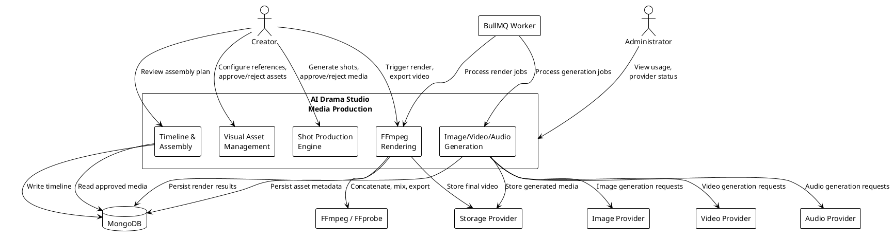

---

## **4. DFX Constraints**

### **4.1 Performance**
1. Image generation requests shall complete or fail within 120 seconds for a single image.
2. Video generation requests shall be submitted asynchronously; the system shall poll for completion at intervals no more frequent than every 10 seconds and no less frequent than every 60 seconds.
3. Video generation operations shall complete or be marked as timed out within 10 minutes of initial submission.
4. Audio generation requests shall complete or fail within 60 seconds for a single audio clip.
5. FFmpeg rendering of a complete film shall complete or fail within 30 minutes for a target duration of up to 15 minutes.
6. Media validation (FFprobe inspection) shall complete within 15 seconds per asset.
7. The system shall support concurrent generation of up to 5 shots per project without degradation.
8. Render job queue concurrency shall be limited to 1 to prevent resource contention on the rendering machine.

### **4.2 Reliability**
1. The system availability target is 99% for the application layer; media generation availability depends on the selected provider and is not guaranteed.
2. Generation jobs shall retry up to 3 times for transient failures with exponential backoff.
3. Permanent failures (validation rejection, safety rejection, unknown model) shall not retry automatically.
4. Worker restarts shall preserve all completed assets and re-enqueue jobs with status `queued` or `processing` that have not exceeded their attempt limit.
5. A rejected media asset shall not silently replace an approved asset. The approved asset shall remain until explicitly replaced by the creator.
6. Duplicate generation jobs with the same idempotency key shall return the existing job rather than creating a new one.
7. If object storage succeeds but database persistence fails, the orphaned storage object shall be identifiable through the existing orphan audit mechanism.
8. The system shall distinguish permanent failures from temporary failures and record the failure classification on the job.

### **4.3 Security**
1. Provider API keys shall be stored only in server-side environment variables and shall never appear in client bundles or API responses.
2. All media generation and asset API operations shall verify project and asset ownership using the existing `clerkUserId` ownership pattern.
3. Uploaded files shall be validated for MIME type, file signature, and size before storage.
4. Storage paths shall be generated by the system from hashed identifiers; user-supplied paths shall not be accepted.
5. FFmpeg rendering commands shall be constructed as argument arrays, not shell strings, to prevent arbitrary shell execution.
6. External provider responses shall be treated as untrusted data and validated before use.
7. Raw filesystem paths and storage keys shall not be exposed in API responses.
8. Media downloads shall be authenticated and ownership-checked before streaming.
9. Provider secrets shall never be logged in job records or error messages.

### **4.4 Maintainability**
1. All media generation operations shall be logged with provider, model, job ID, project ID, duration, and outcome.
2. Generation job records shall include enough information to reproduce a generation request without re-deriving prompts.
3. The system shall track provider failures separately from validation failures for operational monitoring.
4. Cost and usage events shall be recorded when a generation job reaches a terminal state.
5. Render job records shall include FFmpeg version, input assets, render settings, output asset, render duration, and error details.
6. The system shall expose provider capability declarations so that the production engine can determine available operations without trial-and-error API calls.

### **4.5 Compatibility**
1. The existing MediaAsset model, StorageProvider interface, GenerationJob model, ProductionScene model, and CanonicalEntity model shall be reused and extended, not replaced.
2. The existing BullMQ queue system and worker infrastructure shall be reused for all background jobs.
3. The existing project status transition function shall be preserved; new media-production stages shall integrate with the existing transition table.
4. The existing CSS Modules styling approach shall be maintained; no Tailwind or alternative styling system shall be introduced.
5. The existing Clerk authentication and ownership patterns shall be preserved for all new API routes.
6. New job types shall be added to the existing `JOB_TYPES` array without removing or reordering existing types.
7. The application shall remain functional during development when no paid API credits are configured, using mock providers.

---

## **5. Core Capabilities**

## **5.1 Visual Asset Management**

### **5.1.1 Business Rules**

1. **Character Visual Profile Creation**: Each character extracted from an approved screenplay shall have a visual profile containing character identity, name, age description, physical appearance, facial characteristics, hair, clothing, distinguishing features, body type, voice characteristics, default visual presentation, and visual continuity notes.
   a. Acceptance criteria: WHEN a character is extracted from an approved screenplay THE SYSTEM SHALL create or update a character visual profile linked to that character and project.

2. **Character Reference Image Generation**: The system shall support generating character reference images including primary portrait, full-body reference, alternative clothing, and different emotional expressions.
   a. Acceptance criteria: WHEN the creator requests a character reference image THE SYSTEM SHALL enqueue an image generation job using the character's visual profile and store the result as a MediaAsset of type `character_reference`.

3. **Character Reference Image Upload**: The system shall support uploading existing images as character references.
   a. Acceptance criteria: WHEN the creator uploads an image for a character THE SYSTEM SHALL validate the file, store it through the StorageProvider, and create a MediaAsset of type `character_reference` associated with the project and character.

4. **Approved Reference as Canon**: Only approved visual references shall automatically become the default canon references for subsequent production.
   a. Acceptance criteria: WHEN a character reference image is approved THE SYSTEM SHALL designate it as the default visual reference for that character in subsequent image and video generation.
   b. Acceptance criteria: WHEN a character reference image is in `draft`, `generating`, `under_review`, `rejected`, or `archived` status THE SYSTEM SHALL NOT use it as a default canon reference.

5. **No Automatic Canon Replacement**: The system shall not automatically replace an approved reference when generating new images.
   a. Acceptance criteria: WHEN a new character reference image is generated while an approved reference exists THE SYSTEM SHALL store the new image with status `under_review` and SHALL NOT change the existing approved reference.

6. **Explicit Canon Replacement**: The creator shall be able to approve a new visual version explicitly, replacing the previous canon reference.
   a. Acceptance criteria: WHEN the creator approves a new reference image for a character that already has an approved reference THE SYSTEM SHALL archive the previous approved reference, designate the new one as canon, and preserve version history.

7. **Environment Visual Profile Creation**: Each location used in approved scenes shall have an environment visual profile containing location name, description, geography, architecture, dominant materials, colour palette, lighting characteristics, weather, atmosphere, important environmental objects, and continuity notes.
   a. Acceptance criteria: WHEN a scene breakdown is approved with a location THE SYSTEM SHALL create or update an environment visual profile for that location.

8. **Environment Variation Support**: The system shall support primary environment reference, alternative camera perspectives, different lighting conditions, time-of-day variations, and weather variations.
   a. Acceptance criteria: WHEN the creator requests an environment reference with specific lighting or weather conditions THE SYSTEM SHALL generate and store the variation while associating it with the same environment profile.

9. **Environment Change Distinction**: The system shall distinguish legitimate changes in lighting or weather from changes to the actual location.
   a. Acceptance criteria: WHEN an environment reference is generated with different lighting THE SYSTEM SHALL record the lighting condition as a variation of the same environment, not as a new environment.

10. **Object Visual Profile Creation**: The system shall track important story objects including weapons, documents, jewellery, vehicles, magical objects, equipment, and story-specific props.
    a. Acceptance criteria: WHEN the creator identifies an important story object THE SYSTEM SHALL create an object visual profile and support generating or uploading reference images for it.

11. **Visual Asset Status Lifecycle**: Visual assets shall transition through statuses: `draft` → `generating` → `generated` → `under_review` → `approved` or `rejected`, and `approved` → `archived`.
    a. Acceptance criteria: WHEN a visual asset is created THE SYSTEM SHALL assign it status `draft` or `generating`.
    b. Acceptance criteria: WHEN generation completes THE SYSTEM SHALL set status to `generated` and then `under_review`.
    c. Acceptance criteria: WHEN the creator approves a visual asset THE SYSTEM SHALL set status to `approved`.
    d. Acceptance criteria: WHEN the creator rejects a visual asset THE SYSTEM SHALL set status to `rejected` and SHALL NOT use it in production.

12. **Prohibition — No Invented Appearance**: The image generation system shall not invent a different appearance for an established character on every generation.
    a. Acceptance criteria: WHEN an approved character reference exists and a new image is generated for that character THE SYSTEM SHALL include the approved reference as input to the image generation request.

### **5.1.2 Interaction Flow**

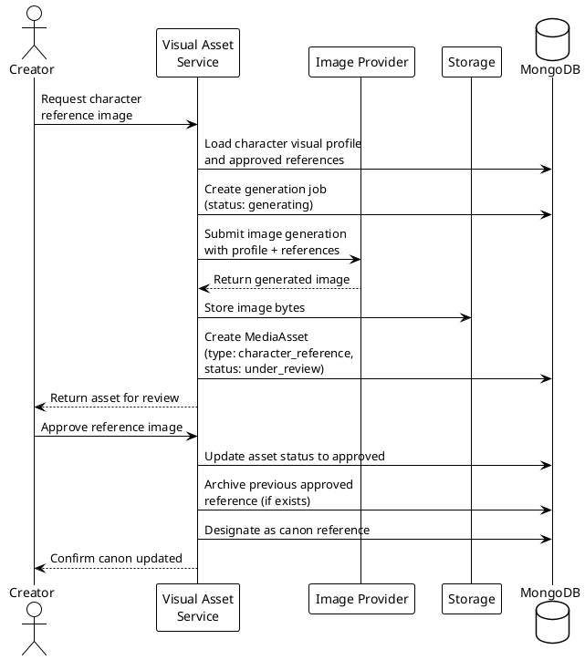

### **5.1.3 Exception Scenarios**

1. **Image Provider Unavailable**
   a. Trigger condition: The configured image generation provider is unreachable or returns an error.
   b. System behavior: The job is retried up to the attempt limit with exponential backoff. If all attempts fail, the job is marked as failed with error classification.
   c. User perception: The creator sees the asset status as `generating` with an error message, and can retry manually.

2. **Reference Image Rejected by Provider**
   a. Trigger condition: The image provider rejects the reference image input (unsupported format, resolution, or content policy).
   b. System behavior: The system records that the generation was text-only without reference, and proceeds with text-to-image generation if supported.
   c. User perception: The creator sees a note that the reference was not used and the image was generated from text only.

3. **Duplicate Reference Upload**
   a. Trigger condition: The creator uploads an image with the same content hash as an existing asset.
   b. System behavior: The system detects the duplicate via SHA-256 content hash and returns the existing asset record.
   c. User perception: The creator sees a message that the image already exists and is shown the existing asset.

---

## **5.2 Shot-Level Production Engine**

### **5.2.1 Business Rules**

1. **Shot Production Record Extension**: Every production shot shall extend the existing shot plan with project ID, episode ID, scene ID, shot ID, shot number, shot purpose, shot description, visual action, characters appearing, environment, camera framing, camera angle, camera movement, lighting, atmosphere, intended duration, dialogue requirements, character reference assets, environment reference assets, object reference assets, image prompt, video prompt, generation provider, generation settings, production status, resulting media assets, and validation information.
   a. Acceptance criteria: WHEN a shot plan is approved THE SYSTEM SHALL create shot production records for each shot in the plan, reusing the existing shot plan fields.

2. **Production Workflow Sequence**: The production workflow shall follow: approved screenplay → approved scene breakdown → approved shot plan → shot production → generated media → media validation → creator review → approved shot media.
   a. Acceptance criteria: WHEN a shot production is requested THE SYSTEM SHALL verify that the screenplay, scene breakdown, and shot plan are all approved before enqueuing generation.

3. **Scene Completion Gate**: A scene shall not be marked complete merely because its shot-generation requests were submitted. It shall only become complete when all required shots have acceptable approved media.
   a. Acceptance criteria: WHEN all shots in a scene have approved media THE SYSTEM SHALL mark the scene as production-complete.
   b. Acceptance criteria: WHEN any shot in a scene lacks approved media THE SYSTEM SHALL NOT mark the scene as complete.

4. **Individual Shot Generation**: The system shall support generating one shot at a time and generating all eligible shots in a scene or episode through queued jobs.
   a. Acceptance criteria: WHEN the creator requests generation of a single shot THE SYSTEM SHALL enqueue a generation job for that shot only.
   b. Acceptance criteria: WHEN the creator requests generation of all shots in a scene THE SYSTEM SHALL enqueue generation jobs for all eligible shots in that scene.

5. **Shot Regeneration**: The creator shall be able to regenerate a failed shot, regenerate a rejected shot, replace an asset, approve a result, reject a result, view generation details, and retry without unnecessarily regenerating successful shots.
   a. Acceptance criteria: WHEN the creator requests regeneration of a failed shot THE SYSTEM SHALL create a new generation job for that shot.
   b. Acceptance criteria: WHEN the creator requests regeneration of a rejected shot THE SYSTEM SHALL create a new generation job and SHALL NOT delete the rejected asset.
   c. Acceptance criteria: WHEN the creator retries a scene THE SYSTEM SHALL only regenerate shots that are failed, rejected, or not yet generated, and SHALL NOT regenerate shots with approved media.

6. **Rejected Asset Protection**: A rejected media asset shall not silently replace an approved one.
   a. Acceptance criteria: WHEN a shot generation produces a new asset that is rejected THE SYSTEM SHALL preserve any previously approved asset for that shot.

7. **Shot Duration Respect**: The system shall respect the shot duration estimated by the shot planner, but provider-specific duration restrictions shall be handled by the provider adapter.
   a. Acceptance criteria: WHEN a requested shot duration exceeds the provider's maximum supported duration THE SYSTEM SHALL either use supported duration segments, split the shot into multiple planned segments when continuity can be maintained, or report that the provider cannot fulfill the request.
   b. Acceptance criteria: WHEN a shot duration is adjusted due to provider limitations THE SYSTEM SHALL NOT silently change the intended scene duration and SHALL record the adjustment.

8. **Prohibition — No Silent Scene Completion**: The system shall not mark a scene as complete based solely on submitted generation requests.
   a. Acceptance criteria: WHEN generation jobs are submitted for all shots in a scene but not all have completed with approved media THE SYSTEM SHALL keep the scene status as `in_progress`.

### **5.2.2 Interaction Flow**

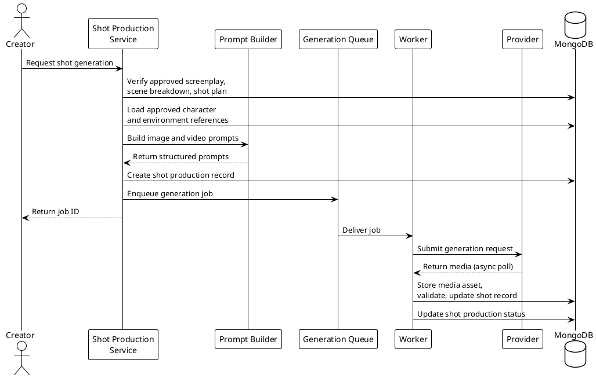

### **5.2.3 Exception Scenarios**

1. **Missing Approved References**
   a. Trigger condition: A shot requires character or environment references, but none are approved.
   b. System behavior: The system proceeds with text-only generation and records that no references were used.
   c. User perception: The creator sees a warning that the shot was generated without visual references.

2. **Provider Duration Exceeded**
   a. Trigger condition: The shot's intended duration exceeds the provider's maximum clip duration.
   b. System behavior: The system splits the shot into multiple segments if continuity can be maintained, or reports the limitation.
   c. User perception: The creator sees the shot split into segments or an error explaining the provider limitation.

3. **Shot Generation Timeout**
   a. Trigger condition: A video generation job does not complete within the timeout period.
   b. System behavior: The job is marked as failed with error code `timeout` and classified as retryable.
   c. User perception: The creator sees the shot status as `failed` with a timeout message and can retry.

---

## **5.3 Image Generation System**

### **5.3.1 Business Rules**

1. **Provider-Independent Interface**: The image generation interface shall be provider-independent. The rest of the application shall not depend directly on a particular image-generation vendor.
   a. Acceptance criteria: WHEN a new image provider is added THE SYSTEM SHALL require only a new adapter and registry entry, with no changes to the production engine.

2. **Image Generation Modes**: The interface shall support text-to-image generation, image-to-image generation where supported, reference image inputs, aspect ratio, resolution, seed, style instructions, negative prompts, provider-specific options, generation status, error classification, returned image URLs or files, and usage/cost information.
   a. Acceptance criteria: WHEN a provider supports image-to-image generation THE SYSTEM SHALL accept reference images as input.
   b. Acceptance criteria: WHEN a provider does not support image-to-image generation THE SYSTEM SHALL fall back to text-to-image and record that references were not used.

3. **Provider Adapter Requirements**: The system shall initially support a mock provider for automated tests and development, an optional local image-generation provider where practical, and an adapter structure for commercial providers.
   a. Acceptance criteria: WHEN no image provider is configured THE SYSTEM SHALL use the mock provider and clearly mark output as mock.
   b. Acceptance criteria: WHEN the mock provider is used THE SYSTEM SHALL NOT mark the output as real media.

4. **No Mandatory Local Generation**: Local image generation shall not be mandatory. The system shall not assume the user's hardware can run demanding local image models.
   a. Acceptance criteria: WHEN local image generation is not configured THE SYSTEM SHALL remain functional using mock or cloud providers.

5. **No Mandatory Paid Services**: The system shall not introduce paid services that require credits without explicit configuration.
   a. Acceptance criteria: WHEN a paid image provider is not explicitly configured with an API key THE SYSTEM SHALL not attempt to call it.

6. **Structured Prompt Building**: Image prompts shall be assembled from shot description, approved character visual profiles, approved character references, approved environment references, relevant object references, project visual style, scene lighting and atmosphere, camera instructions, and continuity requirements.
   a. Acceptance criteria: WHEN an image prompt is built THE SYSTEM SHALL select only relevant information, not concatenate the entire Story Bible.

7. **Image Generation Result Recording**: Generated images shall be stored as MediaAssets with provider, model, prompt, reference assets, generation settings, resolution, aspect ratio, file type, storage location, generation time, validation result, and approval status.
   a. Acceptance criteria: WHEN an image is generated THE SYSTEM SHALL create a MediaAsset record with all generation metadata and store the image bytes through the StorageProvider.

8. **Image Preview Before Approval**: The system shall support previewing images before approval.
   a. Acceptance criteria: WHEN an image is generated THE SYSTEM SHALL make it available for preview with status `under_review` before the creator approves or rejects it.

### **5.3.2 Interaction Flow**

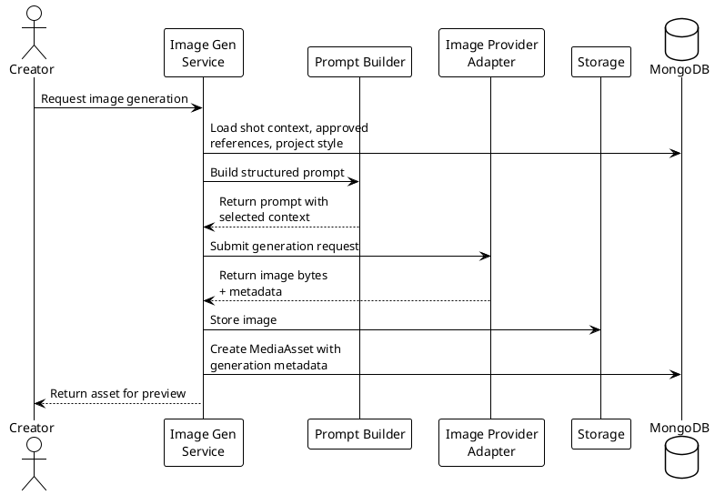

### **5.3.3 Exception Scenarios**

1. **Provider Rate Limit Exceeded**
   a. Trigger condition: The image provider returns a rate limit error.
   b. System behavior: The job is retried with exponential backoff up to the attempt limit.
   c. User perception: The creator sees the job status as retrying with a rate limit message.

2. **Generated Image Validation Failure**
   a. Trigger condition: The generated image bytes fail MIME or signature validation.
   b. System behavior: The job is marked as failed with error code `invalid_media` and classified as non-retryable.
   c. User perception: The creator sees an error that the generated image was invalid.

3. **No Provider Configured**
   a. Trigger condition: No image generation provider is configured or available.
   b. System behavior: The system uses the mock provider and marks the output as mock.
   c. User perception: The creator sees a mock placeholder image with a clear indication that no real provider was used.

---

## **5.4 Video Generation System**

### **5.4.1 Business Rules**

1. **Provider-Independent Video Architecture**: The video generation interface shall be provider-independent. The production engine shall not be coupled directly to any specific video provider.
   a. Acceptance criteria: WHEN a new video provider is added THE SYSTEM SHALL require only a new adapter and registry entry.

2. **Video Generation Capabilities**: The interface shall support, where providers permit: text-to-video, image-to-video, reference-guided video, start-frame and end-frame generation, clip duration, aspect ratio, resolution, frame rate, camera motion instructions, character and environment references, negative prompts, provider-specific settings, asynchronous generation, job status polling, result downloading, error handling, and usage/cost information.
   a. Acceptance criteria: WHEN a provider supports image-to-video THE SYSTEM SHALL accept a reference image as input.
   b. Acceptance criteria: WHEN a provider does not support a feature THE SYSTEM SHALL report that the feature is unavailable, not silently skip it.

3. **Provider Capability Exposure**: The system shall expose provider capabilities so that the production engine can determine which operations are available without making trial API calls.
   a. Acceptance criteria: WHEN the production engine needs to determine if a provider supports image-to-video THE SYSTEM SHALL query the provider capability declaration, not make a test API call.

4. **No False Capability Assumptions**: The system shall not pretend every provider supports every feature.
   a. Acceptance criteria: WHEN a provider does not support reference-guided video THE SYSTEM SHALL declare that capability as unsupported and not attempt to pass references.

5. **Google Veo Integration Readiness**: The architecture shall accommodate Google Veo through an adapter without hardcoding Veo-specific assumptions into the core production pipeline.
   a. Acceptance criteria: WHEN a Veo adapter is implemented THE SYSTEM SHALL handle request submission, operation identifiers, asynchronous job tracking, status polling, completion detection, result retrieval, downloading, media validation, asset registration, and failure/timeout handling.

6. **Video Job Completion Definition**: A video-generation job shall not be marked successful merely because the provider accepted the request. The job is complete only after the video has been retrieved, validated, and registered as a MediaAsset.
   a. Acceptance criteria: WHEN a video provider accepts a generation request THE SYSTEM SHALL keep the job status as `processing` until the video is downloaded, validated, and stored.
   b. Acceptance criteria: WHEN the video is downloaded and validated THE SYSTEM SHALL create a MediaAsset and mark the job as `completed`.

7. **No Paid API Calls in Tests**: The system shall not make paid API calls during automated tests.
   a. Acceptance criteria: WHEN automated tests run THE SYSTEM SHALL use mock providers and SHALL NOT call any paid video generation API.

8. **No Automatic Paid Generation**: The system shall not initiate real paid generation without explicit creator configuration and approval.
   a. Acceptance criteria: WHEN a paid video provider is not explicitly enabled THE SYSTEM SHALL not submit generation requests to it.

9. **Video Prompt Description of Motion**: The video prompt shall describe what happens during the clip, not merely describe a static image. It shall combine shot action, character identity, approved visual references, environment, camera movement, framing, lighting, atmosphere, intended action, motion details, scene continuity, shot duration, and style consistency.
   a. Acceptance criteria: WHEN a video prompt is built for a shot of a character walking THE SYSTEM SHALL describe the walking motion, environmental response (e.g., clothing responding to wind), and camera movement, not just the character's static appearance.

10. **Video Generation Constraint Handling**: If a provider only generates short clips, each generated clip shall be treated as an individual shot, preserving the approved shot order, maintaining reference images, tracking continuity between adjacent shots, and allowing multiple clips to form one scene.
    a. Acceptance criteria: WHEN a provider's maximum clip duration is shorter than the shot's intended duration THE SYSTEM SHALL generate multiple clips and associate them with the same shot.

11. **Prohibition — No Silent Provider Switching**: The system shall not silently switch to a paid provider when a free or local provider fails.
    a. Acceptance criteria: WHEN a free or local video provider fails THE SYSTEM SHALL mark the job as failed and SHALL NOT automatically retry with a paid provider.

12. **Prohibition — No Silent Model Change**: The system shall not silently change the requested model.
    a. Acceptance criteria: WHEN a video generation job specifies a model THE SYSTEM SHALL use that model or fail, not substitute a different model without creator knowledge.

### **5.4.2 Interaction Flow**

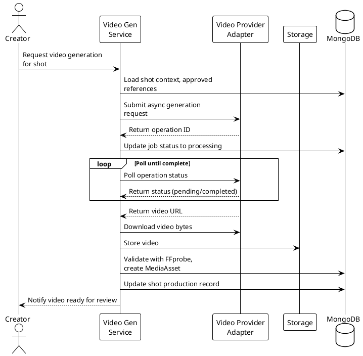

### **5.4.3 Exception Scenarios**

1. **Video Provider Operation Timeout**
   a. Trigger condition: The video provider's asynchronous operation does not complete within the timeout period.
   b. System behavior: The job is marked as failed with error code `timeout`, classified as retryable, and the operation is abandoned.
   c. User perception: The creator sees the shot status as `failed` with a timeout message.

2. **Video Download Failure**
   a. Trigger condition: The provider reports completion but the video cannot be downloaded.
   b. System behavior: The job is retried up to the attempt limit. If download continues to fail, the job is marked as failed.
   c. User perception: The creator sees an error that the video could not be retrieved.

3. **Invalid Video from Provider**
   a. Trigger condition: The downloaded video fails FFprobe validation (missing streams, invalid duration, corrupt file).
   b. System behavior: The video is rejected, the job is marked as failed with error code `invalid_video`, and no MediaAsset is created.
   c. User perception: The creator sees an error that the generated video was invalid.

4. **Provider Content Policy Rejection**
   a. Trigger condition: The video provider rejects the prompt due to content policy.
   b. System behavior: The job is marked as failed with error code `content_rejected`, classified as non-retryable.
   c. User perception: The creator sees an error that the content was rejected by the provider's safety policy.

---

## **5.5 Audio Production**

### **5.5.1 Business Rules**

1. **Voice Profile Persistence**: The system shall maintain persistent voice profiles for characters containing character identity, voice description, preferred voice provider, voice identifier, language, accent, speaking style, emotional characteristics, and approved voice samples.
   a. Acceptance criteria: WHEN a character is established THE SYSTEM SHALL support creating a voice profile linked to that character.

2. **Voice Consistency Across Episodes**: The system shall maintain voice consistency across episodes. It shall not automatically assign a different voice to the same character in each episode.
   a. Acceptance criteria: WHEN a character with an approved voice profile appears in a new episode THE SYSTEM SHALL use the same voice provider and identifier.

3. **Dialogue Source Authority**: The approved screenplay shall be the authoritative source for dialogue. The system shall identify speaker, spoken text, emotional delivery, scene, associated shot, language, and intended timing.
   a. Acceptance criteria: WHEN dialogue is generated THE SYSTEM SHALL use the approved screenplay's dialogue lines as input.
   b. Acceptance criteria: WHEN the screenplay does not contain dialogue for a speaker THE SYSTEM SHALL NOT invent new dialogue.

4. **Dialogue Revision Before Generation**: The creator shall be able to revise dialogue before audio generation.
   a. Acceptance criteria: WHEN the creator edits dialogue before audio generation THE SYSTEM SHALL use the revised text for generation while preserving the original screenplay.

5. **Sound Effect Generation**: The system shall generate or source suitable audio for wind, rain, footsteps, doors, vehicles, water, crowds, environmental atmosphere, and story-specific effects.
   a. Acceptance criteria: WHEN a scene requires ambient sound THE SYSTEM SHALL support generating or sourcing appropriate sound effect audio associated with that scene or shot.

6. **Music Asset Management**: The system shall support background music and soundtrack assets with asset source, licensing information, duration, mood, scene association, volume, and start/end position.
   a. Acceptance criteria: WHEN a music asset is added to a scene THE SYSTEM SHALL record its association, volume, and timing.

7. **Prohibition — No Unlicensed Music**: The system shall not use unlicensed copyrighted music.
   a. Acceptance criteria: WHEN a music asset is added THE SYSTEM SHALL require licensing or usage information to be recorded.

8. **Audio Validation**: Generated audio shall be validated using FFprobe, recording duration, sample rate, channels, codec, file size, and MIME type.
   a. Acceptance criteria: WHEN an audio asset is generated or uploaded THE SYSTEM SHALL validate it with FFprobe and record the technical metadata.

9. **Dialogue-Duration Mismatch Detection**: The system shall provide a mechanism to detect dialogue and clip-duration mismatches.
   a. Acceptance criteria: WHEN dialogue audio duration exceeds the associated shot's video duration THE SYSTEM SHALL flag the mismatch for creator attention.

### **5.5.2 Interaction Flow**

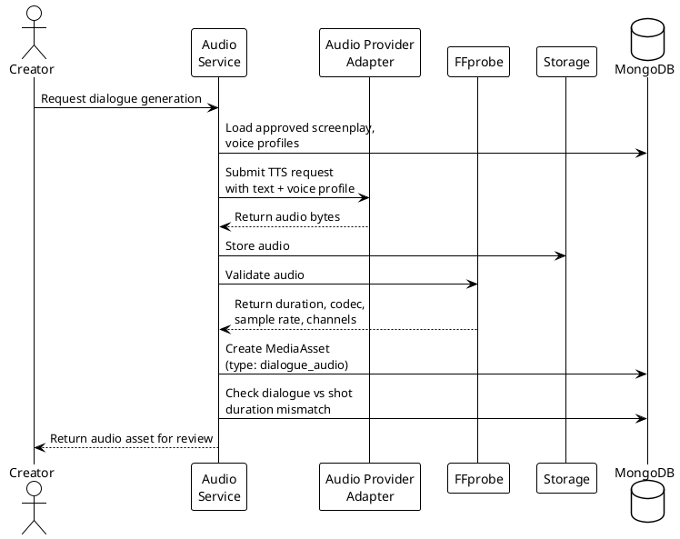

### **5.5.3 Exception Scenarios**

1. **Missing Voice Profile**
   a. Trigger condition: Dialogue generation is requested for a character without a voice profile.
   b. System behavior: The system prompts the creator to configure a voice profile before proceeding.
   c. User perception: The creator sees a message that a voice profile is required.

2. **Audio Provider Unavailable**
   a. Trigger condition: The configured audio generation provider is unreachable.
   b. System behavior: The job is retried with backoff. If all attempts fail, the job is marked as failed.
   c. User perception: The creator sees the audio job status as failed with an error message.

3. **Invalid Audio Output**
   a. Trigger condition: Generated audio fails FFprobe validation.
   b. System behavior: The audio is rejected, no MediaAsset is created, and the job is marked as failed.
   c. User perception: The creator sees an error that the generated audio was invalid.

---

## **5.6 Media Storage and Asset Management**

### **5.6.1 Business Rules**

1. **Storage Provider Abstraction**: Media storage shall be provider-independent, supporting local storage for development and future cloud object storage for images, video assets, audio assets, thumbnails, generated previews, and final renders.
   a. Acceptance criteria: WHEN a new storage provider is configured THE SYSTEM SHALL route storage operations through the provider abstraction without changing business logic.

2. **No Binary Data in Database**: The system shall not store large binary media directly in MongoDB. Metadata shall be stored in the database and actual files through the storage abstraction.
   a. Acceptance criteria: WHEN a media asset is stored THE SYSTEM SHALL store file bytes in the StorageProvider and metadata in MongoDB.

3. **Asset Relationships**: Each asset shall be associated with the appropriate project, episode, character, environment, object, scene, shot, or render. An asset may have multiple relevant relationships.
   a. Acceptance criteria: WHEN a shot video is stored THE SYSTEM SHALL associate the MediaAsset with the project, episode, scene, and shot.

4. **Asset Lifecycle Support**: The system shall support upload, generation, validation, approval, replacement, archiving, and safe deletion of assets.
   a. Acceptance criteria: WHEN an asset is archived THE SYSTEM SHALL mark it as archived but preserve the file and metadata.
   b. Acceptance criteria: WHEN an asset is replaced THE SYSTEM SHALL preserve version history of the previous asset.

5. **Prohibition — No Unsafe Deletion**: The system shall never delete an asset still referenced by an approved episode or render without a clear dependency check.
   a. Acceptance criteria: WHEN deletion is requested for an asset referenced by an approved episode or render THE SYSTEM SHALL reject the deletion and report the dependencies.

6. **Unique Asset Identifiers**: The system shall implement unique asset identifiers, safe filenames, file integrity checks, content hashes, duplicate detection, download failure handling, cleanup of incomplete temporary files, and storage usage tracking.
   a. Acceptance criteria: WHEN two assets have the same content hash THE SYSTEM SHALL detect the duplicate and report it.

7. **Stable Asset References**: The system shall use stable asset identifiers and storage-provider operations, not local file paths, to reference assets.
   a. Acceptance criteria: WHEN the storage backend changes THE SYSTEM SHALL still be able to locate assets by their stable identifiers.

8. **Storage Path Safety**: Storage paths shall not be manipulable to access arbitrary files.
   a. Acceptance criteria: WHEN a storage key is generated THE SYSTEM SHALL derive it from hashed system identifiers, not user-supplied paths.

### **5.6.2 Interaction Flow**

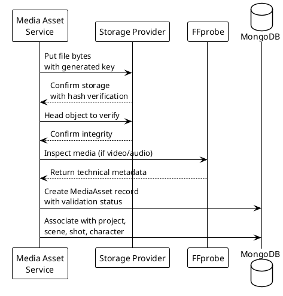

### **5.6.3 Exception Scenarios**

1. **Storage Write Failure**
   a. Trigger condition: The StorageProvider fails to write the file.
   b. System behavior: The operation fails with error code `storage_write_failed`. No MediaAsset record is created.
   c. User perception: The creator sees an error that storage could not save the file.

2. **Storage Verification Mismatch**
   a. Trigger condition: The stored object's hash or size does not match the source.
   b. System behavior: The system deletes the corrupt stored object and reports `storage_verification_failed`.
   c. User perception: The creator sees an error that the file could not be verified after storage.

3. **Asset Not Found on Read**
   a. Trigger condition: A MediaAsset record exists but the stored file is missing.
   b. System behavior: The system reports `media_missing` and does not stream invalid data.
   c. User perception: The creator sees an error that the media file is unavailable.

---

## **5.7 Timeline and Film Assembly**

### **5.7.1 Business Rules**

1. **Timeline Structure**: A film timeline shall support ordered video clips, scene grouping, audio tracks (dialogue, narration, music, sound effects), clip start positions, clip durations, audio offsets, transitions, subtitles, aspect ratio, output resolution, and frame rate.
   a. Acceptance criteria: WHEN a timeline is created THE SYSTEM SHALL represent all video and audio elements in an ordered structure with timing information.

2. **Automatic Timeline Generation**: The system shall generate an initial timeline automatically from approved production material using approved scene order, approved shot order, actual generated video durations, approved dialogue, audio asset durations, scene transitions, and episode duration target.
   a. Acceptance criteria: WHEN all required media for an episode is approved THE SYSTEM SHALL generate a timeline from the approved material.

3. **Actual Duration Preference**: The system shall not rely exclusively on estimated shot durations when actual media durations are available.
   a. Acceptance criteria: WHEN a shot has an actual generated video duration THE SYSTEM SHALL use the actual duration for timeline positioning, not the estimated duration.

4. **Missing Media Detection**: Before rendering, the system shall check that all required assets exist and are valid. If required media is missing, the system shall identify the missing shots or audio, display the missing assets, prevent an invalid final render, and allow the creator to return to the relevant production stage.
   a. Acceptance criteria: WHEN required media is missing THE SYSTEM SHALL prevent rendering and list the missing assets.
   b. Acceptance criteria: WHEN all required media is present and valid THE SYSTEM SHALL allow rendering to proceed.

5. **Optional Asset Identification**: Optional assets shall be clearly identified as optional.
   a. Acceptance criteria: WHEN an asset is optional (e.g., background music) THE SYSTEM SHALL mark it as optional and SHALL NOT block rendering if it is missing.

6. **Assembly Validation**: The system shall validate no missing required clips, no broken asset references, no unintended gaps, no accidental overlaps, audio alignment, expected total duration, output aspect ratio, frame rate, and subtitle timing.
   a. Acceptance criteria: WHEN the assembly plan has overlapping clips THE SYSTEM SHALL flag the overlap as a validation error.
   b. Acceptance criteria: WHEN the assembly plan has broken asset references THE SYSTEM SHALL flag each broken reference.

7. **Assembly Preview and Approval**: The creator shall be able to preview and approve the assembly plan before rendering.
   a. Acceptance criteria: WHEN an assembly plan is generated THE SYSTEM SHALL present it for preview before rendering.
   b. Acceptance criteria: WHEN the creator has not approved the assembly plan THE SYSTEM SHALL NOT start rendering.

### **5.7.2 Interaction Flow**

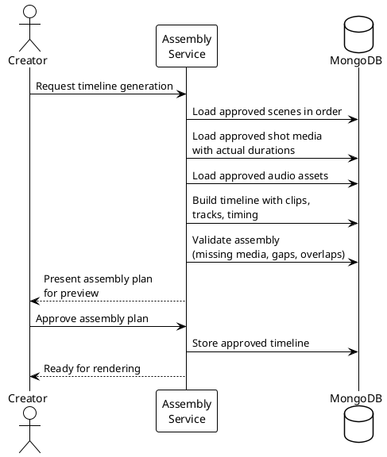

### **5.7.3 Exception Scenarios**

1. **Missing Required Media**
   a. Trigger condition: One or more required shots or audio assets are missing or not approved.
   b. System behavior: The system prevents timeline generation or flags the missing assets in the assembly plan.
   c. User perception: The creator sees a list of missing required assets and cannot proceed to rendering.

2. **Duration Mismatch Between Shots**
   a. Trigger condition: The sum of actual clip durations differs significantly from the episode target duration.
   b. System behavior: The system flags the mismatch as a warning in the assembly validation.
   c. User perception: The creator sees a warning about duration mismatch and can adjust or proceed.

3. **Broken Asset Reference**
   a. Trigger condition: A timeline clip references a MediaAsset that no longer exists or is not storage-verified.
   b. System behavior: The system flags the broken reference and prevents rendering.
   c. User perception: The creator sees which asset is broken and can regenerate or replace it.

---

## **5.8 FFmpeg Rendering**

### **5.8.1 Business Rules**

1. **Real Rendering Pipeline**: The system shall replace the current mock rendering with a real FFmpeg rendering service supporting concatenating video clips, normalizing dimensions, normalizing frame rates, handling different codecs, audio mixing, dialogue and narration, background music, sound effects, subtitle rendering, audio fades, video transitions, output aspect ratio, output resolution, and output format.
   a. Acceptance criteria: WHEN a render job is processed THE SYSTEM SHALL execute FFmpeg with the assembled timeline and produce a real video file.

2. **FFmpeg Configuration via Environment**: The system shall use environment configuration for FFmpeg and FFprobe executable paths and shall verify that the executables are available before use.
   a. Acceptance criteria: WHEN FFmpeg is not configured or not found THE SYSTEM SHALL report `ffmpeg_not_configured` and SHALL NOT attempt rendering.

3. **Render Presets**: The system shall support vertical 9:16 (TikTok, YouTube Shorts), landscape 16:9 (YouTube), and square 1:1 presets, with configurable output resolution and frame rate.
   a. Acceptance criteria: WHEN the creator selects a 9:16 preset THE SYSTEM SHALL configure FFmpeg to output a vertical video with the specified resolution and frame rate.

4. **Background Rendering**: Rendering shall run in the background through the existing BullMQ infrastructure.
   a. Acceptance criteria: WHEN a render is triggered THE SYSTEM SHALL enqueue a render job and return a job ID to the creator.

5. **Render Job Status Tracking**: A render job shall track status through queued, processing, completed, failed, and cancelled, recording input assets, render settings, output asset, render duration, error details, FFmpeg version, and start/completion timestamps.
   a. Acceptance criteria: WHEN a render job is queued THE SYSTEM SHALL record the input assets and render settings.
   b. Acceptance criteria: WHEN a render job completes THE SYSTEM SHALL record the output asset, render duration, and FFmpeg version.

6. **Render Validation**: After rendering, the system shall confirm the output exists, inspect it with FFprobe, verify video and audio streams, verify duration, verify resolution, verify file integrity, and register the final output as a MediaAsset.
   a. Acceptance criteria: WHEN FFmpeg exits successfully THE SYSTEM SHALL validate the output with FFprobe before marking the render as completed.
   b. Acceptance criteria: WHEN the output fails FFprobe validation THE SYSTEM SHALL mark the render as failed despite FFmpeg exiting without error.

7. **Prohibition — No Shell Execution**: Rendering commands shall not allow arbitrary shell execution.
   a. Acceptance criteria: WHEN FFmpeg is invoked THE SYSTEM SHALL pass arguments as an array, not interpolate user text into a shell string.

8. **Prohibition — No False Completion**: A render shall not be marked completed merely because the FFmpeg process exited without an error.
   a. Acceptance criteria: WHEN FFmpeg exits with code 0 but the output file is missing or invalid THE SYSTEM SHALL mark the render as failed.

9. **Render Cancellation**: Render cancellation shall stop the FFmpeg process for that job only. Completed assets shall be kept.
   a. Acceptance criteria: WHEN a render job is cancelled THE SYSTEM SHALL terminate the FFmpeg process and preserve any previously completed assets.

10. **Temp File Cleanup**: The system shall clean up temporary files after rendering, regardless of success or failure.
    a. Acceptance criteria: WHEN a render job completes or fails THE SYSTEM SHALL remove temporary download and intermediate files.

### **5.8.2 Interaction Flow**

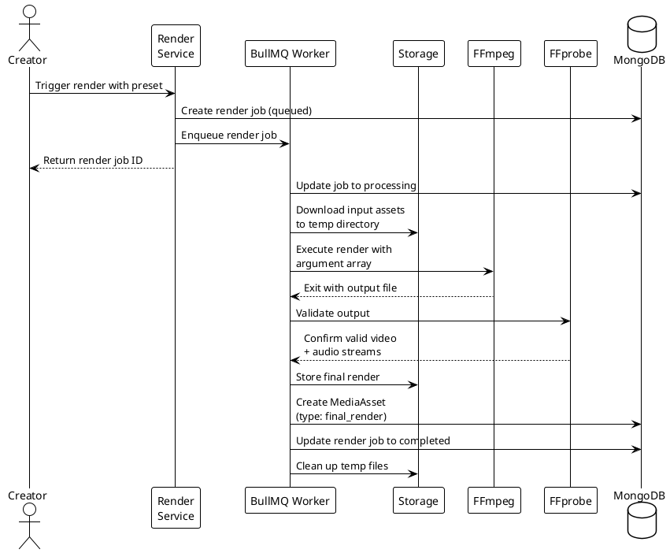

### **5.8.3 Exception Scenarios**

1. **FFmpeg Not Found**
   a. Trigger condition: The FFmpeg executable is not configured or not found at the specified path.
   b. System behavior: The render job is marked as failed with error code `ffmpeg_not_configured`.
   c. User perception: The creator sees an error that FFmpeg is not configured.

2. **FFmpeg Process Failure**
   a. Trigger condition: FFmpeg exits with a non-zero code.
   b. System behavior: The render job is marked as failed, stderr is truncated and stored on the job error, and temporary files are cleaned up.
   c. User perception: The creator sees the render status as failed with an error message.

3. **Output Validation Failure**
   a. Trigger condition: FFmpeg exits successfully but the output fails FFprobe validation.
   b. System behavior: The render job is marked as failed with error code `render_output_invalid`.
   c. User perception: The creator sees an error that the rendered video was invalid.

4. **Render Timeout**
   a. Trigger condition: The FFmpeg process does not complete within the timeout period.
   b. System behavior: The process is terminated, the job is marked as failed with error code `render_timeout`, and temporary files are cleaned up.
   c. User perception: The creator sees the render status as failed with a timeout message.

---

## **5.9 Production Orchestration**

### **5.9.1 Business Rules**

1. **BullMQ Integration**: All media-generation and rendering operations shall integrate with the existing BullMQ architecture. No separate queue system shall be created.
   a. Acceptance criteria: WHEN a media generation or render job is created THE SYSTEM SHALL enqueue it through the existing BullMQ queue.

2. **Job Type Coverage**: The workflow shall support character reference generation, environment reference generation, object reference generation, shot image generation, shot video generation, dialogue generation, sound-effect generation, music generation, media validation, timeline assembly, and final rendering.
   a. Acceptance criteria: WHEN each operation type is triggered THE SYSTEM SHALL create a GenerationJob with the appropriate job type and enqueue it.

3. **Unique Job Identifiers**: The system shall use unique job identifiers and prevent duplicate jobs.
   a. Acceptance criteria: WHEN a job with the same idempotency key already exists and is open THE SYSTEM SHALL return the existing job rather than creating a duplicate.

4. **Bounded Retry Policies**: The system shall use bounded retry policies with exponential backoff and shall preserve completed work.
   a. Acceptance criteria: WHEN a job fails and is retried THE SYSTEM SHALL not regenerate assets that were already successfully completed in the same run.

5. **Failure Classification**: The system shall track provider failures, distinguish permanent failures from temporary failures, handle provider timeouts, handle worker restarts, persist job state, ensure safe cancellation, and prevent concurrent jobs from overwriting the same approved asset.
   a. Acceptance criteria: WHEN a permanent failure occurs THE SYSTEM SHALL not retry automatically.
   b. Acceptance criteria: WHEN a worker restarts THE SYSTEM SHALL re-enqueue jobs with status `queued` or `processing` that have not exceeded their attempt limit.

6. **Provider Selection**: The system shall select providers according to availability, supported capabilities, creator configuration, cost constraints, provider limits, and asset requirements.
   a. Acceptance criteria: WHEN a provider does not support the required capability THE SYSTEM SHALL not select it for that operation.

7. **Prohibition — No Silent Paid Switch**: The system shall not silently switch to a paid provider when a free or local provider fails.
   a. Acceptance criteria: WHEN a free provider fails THE SYSTEM SHALL mark the job as failed and SHALL NOT automatically retry with a paid provider.

8. **Prohibition — No Silent Model Change**: The system shall not silently change the requested model.
   a. Acceptance criteria: WHEN a job specifies a model THE SYSTEM SHALL use that model or fail.

### **5.9.2 Interaction Flow**

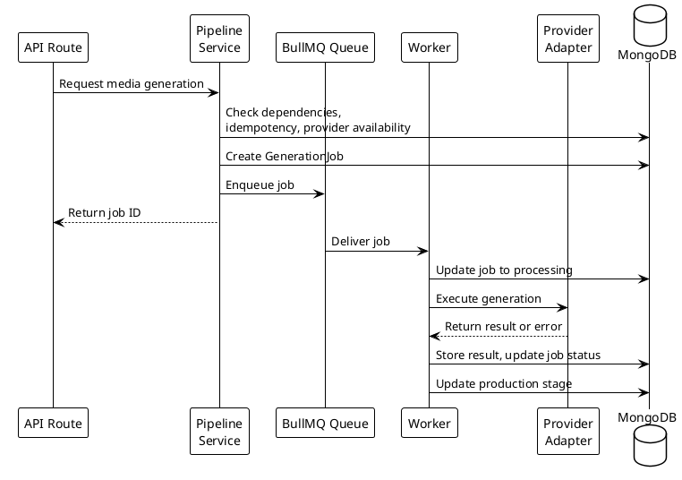

### **5.9.3 Exception Scenarios**

1. **Worker Crash During Processing**
   a. Trigger condition: The worker process crashes while a job is in `processing` status.
   b. System behavior: On worker restart, the job is re-enqueued from MongoDB if it has not exceeded its attempt limit.
   c. User perception: The creator sees the job eventually complete or fail after retry.

2. **Concurrent Job Conflict**
   a. Trigger condition: Two jobs attempt to overwrite the same approved asset simultaneously.
   b. System behavior: The system uses idempotency keys to prevent duplicates and the first job to complete wins; the second job is rejected as a conflict.
   c. User perception: The creator sees one job complete and the other rejected as a duplicate.

3. **All Providers Exhausted**
   a. Trigger condition: No configured provider is available or all providers have failed.
   b. System behavior: The job is marked as failed with error code `no_provider_available`.
   c. User perception: The creator sees an error that no provider was available and can configure a provider or retry.

---

## **5.10 Production Workspaces**

### **5.10.1 Business Rules**

1. **Visual Assets Workspace**: The system shall provide a workspace displaying characters, environments, objects, reference images, and approval states, allowing the creator to preview and manage references.
   a. Acceptance criteria: WHEN the creator opens the Visual Assets workspace THE SYSTEM SHALL display all visual profiles and their reference images with approval states.

2. **Shot Production Workspace**: The system shall provide a workspace displaying scenes, shots, shot descriptions, reference images, generation status, generated image/video, approval controls, and retry/regeneration actions.
   a. Acceptance criteria: WHEN the creator opens the Shot Production workspace THE SYSTEM SHALL display scenes with their shots, generation status, and approval controls.

3. **Audio Production Workspace**: The system shall provide a workspace displaying character dialogue, voice assignments, audio previews, sound effects, music, and generation status.
   a. Acceptance criteria: WHEN the creator opens the Audio Production workspace THE SYSTEM SHALL display dialogue lines with voice assignments and audio previews.

4. **Film Assembly Workspace**: The system shall provide a workspace displaying scene order, shot order, video previews, audio tracks, duration, missing assets, and assembly status.
   a. Acceptance criteria: WHEN the creator opens the Film Assembly workspace THE SYSTEM SHALL display the timeline structure with any missing assets highlighted.

5. **Rendering Workspace**: The system shall provide a workspace displaying render settings, aspect ratio, resolution, progress, errors, final video preview, and export action.
   a. Acceptance criteria: WHEN the creator opens the Rendering workspace THE SYSTEM SHALL display render settings and the status of any active or completed render jobs.

6. **Consistent Navigation**: The workspaces shall use the existing application navigation, styling architecture, and component conventions.
   a. Acceptance criteria: WHEN a new workspace is created THE SYSTEM SHALL use CSS Modules and existing component patterns, not introduce new styling systems.

7. **Prohibition — No Unrelated Redesign**: The system shall not redesign unrelated pages.
   a. Acceptance criteria: WHEN production workspaces are added THE SYSTEM SHALL NOT modify existing story, character, or scene management pages.

### **5.10.2 Interaction Flow**

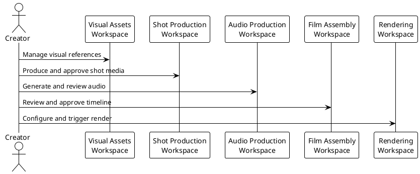

### **5.10.3 Exception Scenarios**

1. **Workspace Data Loading Failure**
   a. Trigger condition: The API call to load workspace data fails.
   b. System behavior: The workspace displays an error state with a retry option.
   c. User perception: The creator sees an error message and can retry loading the workspace.

---

## **5.11 Production Approval and Canon Protection**

### **5.11.1 Business Rules**

1. **Narrative Foundation Preservation**: The approved Story Bible shall remain the narrative foundation. The approved Season Plan shall remain the season blueprint. Approved episodes shall remain the source of established story events.
   a. Acceptance criteria: WHEN media production occurs THE SYSTEM SHALL NOT modify or override approved narrative content.

2. **Visual Canon Preservation**: Approved character visual references shall remain the visual canon. Approved environment references shall remain the environment canon. Approved shot media shall become the selected production material.
   a. Acceptance criteria: WHEN a new visual reference is generated THE SYSTEM SHALL NOT replace the approved canon reference without explicit creator approval.

3. **Rejected Asset Exclusion**: Rejected or draft assets shall not automatically enter the final film.
   a. Acceptance criteria: WHEN an asset is rejected or in draft status THE SYSTEM SHALL NOT include it in the timeline or render.

4. **Version History Preservation**: Replacing an approved asset shall preserve version history.
   a. Acceptance criteria: WHEN an approved asset is replaced THE SYSTEM SHALL archive the previous version and maintain a history of all versions.

5. **Downstream Impact Identification**: A change to an earlier approved stage shall identify affected downstream production material.
   a. Acceptance criteria: WHEN an approved shot plan is modified after shot media has been generated THE SYSTEM SHALL identify which generated media assets are affected.

6. **Prohibition — No Silent Appearance Change**: Visual generation shall not silently change the established appearance of a character.
   a. Acceptance criteria: WHEN a character has an approved visual reference THE SYSTEM SHALL include it in all subsequent image and video generation for that character.

7. **Prohibition — No Silent Narrative Contradiction**: Video generation shall not silently introduce story events that contradict the screenplay.
   a. Acceptance criteria: WHEN a generated clip contains a meaningful narrative change THE SYSTEM SHALL allow the creator to reject it or revise the underlying shot plan.

### **5.11.2 Interaction Flow**

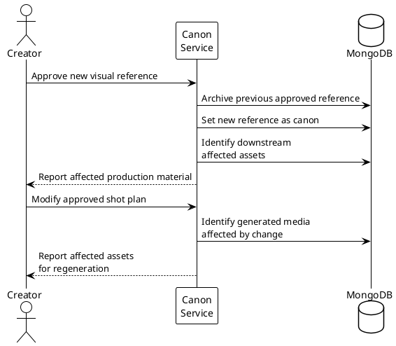

### **5.11.3 Exception Scenarios**

1. **Canon Conflict on Generation**
   a. Trigger condition: A generation request would produce media conflicting with established canon (e.g., different character appearance).
   b. System behavior: The system includes the approved canon reference in the generation request to enforce consistency. If the result still conflicts, the creator can reject it.
   c. User perception: The creator sees the generated media for review and can reject it if it conflicts with canon.

---

## **5.12 Provider and Cost Management**

### **5.12.1 Business Rules**

1. **Provider Configuration**: The system shall support provider configuration, model configuration, optional provider API keys, cost estimates where provider pricing is available, actual usage tracking, generation history, ability to disable paid providers, ability to select local or mock providers, and clear distinction between estimated and actual costs.
   a. Acceptance criteria: WHEN a provider is disabled THE SYSTEM SHALL not attempt to use it for generation.
   b. Acceptance criteria: WHEN a mock provider is selected THE SYSTEM SHALL use it and clearly mark output as mock.

2. **Cost Tracking**: The system shall record cost and usage events for media generation operations when a job reaches a terminal state.
   a. Acceptance criteria: WHEN a generation job completes THE SYSTEM SHALL record the provider, model, and usage information.
   b. Acceptance criteria: WHEN a generation job fails or is cancelled THE SYSTEM SHALL record the event with `billable: false`.

3. **Prohibition — No Paid API in Tests**: The system shall never make paid API requests in tests.
   a. Acceptance criteria: WHEN automated tests run THE SYSTEM SHALL use mock providers exclusively.

4. **Prohibition — No Automatic Expensive Generation**: The system shall never trigger expensive generation automatically without a clear creator action.
   a. Acceptance criteria: WHEN no creator action has initiated generation THE SYSTEM SHALL not submit generation requests to paid providers.

5. **Development Without Credits**: The application shall remain useful during development even when no paid API credits are available.
   a. Acceptance criteria: WHEN no paid API keys are configured THE SYSTEM SHALL function using mock providers for all media generation.

### **5.12.2 Interaction Flow**

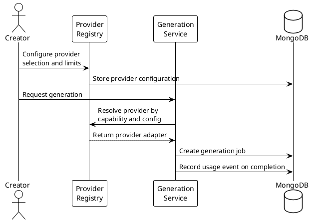

### **5.12.3 Exception Scenarios**

1. **Cost Limit Exceeded**
   a. Trigger condition: A generation request would exceed a configured cost limit.
   b. System behavior: The system rejects the request with error code `cost_limit_exceeded` before submitting to the provider.
   c. User perception: The creator sees an error that the cost limit would be exceeded and can adjust limits or choose a different provider.

2. **Provider Disabled Mid-Job**
   a. Trigger condition: A provider is disabled while a job using it is in progress.
   b. System behavior: The in-progress job is allowed to complete. New jobs are not submitted to the disabled provider.
   c. User perception: The creator sees the current job complete and new jobs routed to an alternative provider.

---

## **6. Data Constraints**

## **6.1 Character Visual Profile**
1. **characterId**: Shall reference an existing character in the project. Required.
2. **projectId**: Shall reference the owning project. Required.
3. **name**: Shall match the character's name in the approved screenplay. Required, max 80 characters.
4. **ageDescription**: Shall describe the character's age as established in the story. Optional, max 120 characters.
5. **physicalAppearance**: Shall describe general physical appearance. Optional, max 800 characters.
6. **facialCharacteristics**: Shall describe facial features. Optional, max 600 characters.
7. **hair**: Shall describe hair style, color, and length. Optional, max 400 characters.
8. **clothing**: Shall describe default clothing. Optional, max 400 characters.
9. **distinguishingFeatures**: Shall describe scars, tattoos, accessories, or unique features. Optional, max 400 characters.
10. **bodyType**: Shall describe body type and posture. Optional, max 300 characters.
11. **voiceCharacteristics**: Shall describe voice qualities. Optional, max 400 characters.
12. **defaultVisualPresentation**: Shall describe the default pose, expression, and framing. Optional, max 500 characters.
13. **visualVariations**: Shall list important visual variations (alternative clothing, injuries, aging). Optional.
14. **referenceImageAssetIds**: Shall reference approved MediaAsset records of type `character_reference`. Optional.
15. **continuityNotes**: Shall describe visual continuity requirements across episodes. Optional, max 800 characters.
16. **status**: Shall be one of: `draft`, `generating`, `generated`, `under_review`, `approved`, `rejected`, `archived`. Required.

## **6.2 Environment Visual Profile**
1. **projectId**: Shall reference the owning project. Required.
2. **locationName**: Shall match the location name from approved scenes. Required, max 160 characters.
3. **description**: Shall describe the location. Required, max 1200 characters.
4. **geography**: Shall describe geographical layout and terrain. Optional, max 600 characters.
5. **architecture**: Shall describe architectural style and features. Optional, max 600 characters.
6. **dominantMaterials**: Shall describe primary construction and surface materials. Optional, max 400 characters.
7. **colourPalette**: Shall describe dominant colors. Optional, max 300 characters.
8. **lightingCharacteristics**: Shall describe typical lighting. Optional, max 400 characters.
9. **weatherAndAtmosphere**: Shall describe typical weather and atmospheric conditions. Optional, max 400 characters.
10. **importantObjects**: Shall list significant environmental objects. Optional.
11. **referenceImageAssetIds**: Shall reference approved MediaAsset records of type `scene_image`. Optional.
12. **continuityNotes**: Shall describe environmental continuity requirements. Optional, max 800 characters.
13. **status**: Shall be one of the visual asset statuses. Required.

## **6.3 Object Visual Profile**
1. **projectId**: Shall reference the owning project. Required.
2. **objectName**: Shall identify the story object. Required, max 120 characters.
3. **objectType**: Shall categorize the object (weapon, document, jewellery, vehicle, magical_object, equipment, prop). Required.
4. **description**: Shall describe the object's appearance. Required, max 800 characters.
5. **referenceImageAssetIds**: Shall reference approved MediaAsset records. Optional.
6. **continuityNotes**: Shall describe continuity requirements. Optional, max 500 characters.
7. **status**: Shall be one of the visual asset statuses. Required.

## **6.4 Shot Production Record**
1. **projectId**: Shall reference the owning project. Required.
2. **episodeId**: Shall reference the episode. Optional.
3. **sceneId**: Shall reference the production scene. Required.
4. **shotId**: Shall uniquely identify the shot within the scene. Required, max 120 characters.
5. **shotNumber**: Shall be a positive integer matching the shot plan. Required.
6. **shotPurpose**: Shall match the shot plan purpose. Required, max 240 characters.
7. **charactersAppearing**: Shall list character names from the approved scene. Required.
8. **environment**: Shall reference the environment visual profile. Optional.
9. **characterReferenceAssetIds**: Shall reference approved character reference MediaAssets. Optional.
10. **environmentReferenceAssetIds**: Shall reference approved environment reference MediaAssets. Optional.
11. **objectReferenceAssetIds**: Shall reference approved object reference MediaAssets. Optional.
12. **imagePrompt**: Shall contain the structured prompt used for image generation. Optional.
13. **videoPrompt**: Shall contain the structured prompt used for video generation. Optional.
14. **generationProvider**: Shall identify the provider used. Optional, max 80 characters.
15. **generationSettings**: Shall contain provider-specific generation parameters. Optional.
16. **productionStatus**: Shall be one of: `pending`, `generating`, `generated`, `validated`, `approved`, `rejected`, `failed`. Required.
17. **resultingMediaAssetIds**: Shall reference MediaAssets produced for this shot. Optional.
18. **validationInfo**: Shall contain validation results for generated media. Optional.

## **6.5 Voice Profile**
1. **characterId**: Shall reference an existing character. Required.
2. **projectId**: Shall reference the owning project. Required.
3. **voiceDescription**: Shall describe the voice qualities. Required, max 400 characters.
4. **preferredProvider**: Shall identify the voice generation provider. Optional, max 80 characters.
5. **voiceIdentifier**: Shall identify the specific voice model ID. Optional, max 160 characters.
6. **language**: Shall specify the language code. Required, max 40 characters.
7. **accent**: Shall describe the accent where supported. Optional, max 80 characters.
8. **speakingStyle**: Shall describe the speaking style. Optional, max 300 characters.
9. **emotionalCharacteristics**: Shall describe emotional range. Optional, max 400 characters.
10. **approvedVoiceSampleAssetIds**: Shall reference approved voice sample MediaAssets. Optional.

## **6.6 Timeline**
1. **projectId**: Shall reference the owning project. Required.
2. **episodeId**: Shall reference the episode. Required.
3. **tracks**: Shall contain ordered timeline tracks. Required.
4. **aspectRatio**: Shall match the project's aspect ratio or a selected render preset. Required.
5. **outputResolution**: Shall specify the target resolution. Required.
6. **frameRate**: Shall specify the target frame rate. Required.
7. **totalDurationSeconds**: Shall be the sum of all clip durations in the primary video track. Required.
8. **status**: Shall be one of: `draft`, `validated`, `approved`, `rendering`, `completed`, `failed`. Required.

## **6.7 Timeline Track**
1. **timelineId**: Shall reference the parent timeline. Required.
2. **trackType**: Shall be one of: `video`, `dialogue`, `narration`, `music`, `sound_effect`. Required.
3. **clips**: Shall contain ordered timeline clips. Required.
4. **volume**: Shall specify the track volume level (0.0 to 1.0). Optional, default 1.0.

## **6.8 Timeline Clip**
1. **trackId**: Shall reference the parent track. Required.
2. **mediaAssetId**: Shall reference a valid, storage-verified MediaAsset. Required.
3. **startPositionSeconds**: Shall specify the clip's start position on the timeline. Required, non-negative.
4. **durationSeconds**: Shall match the asset's actual duration. Required, positive.
5. **sceneNumber**: Shall identify the source scene. Optional.
6. **shotNumber**: Shall identify the source shot. Optional.
7. **isOptional**: Shall indicate whether the clip is optional for rendering. Required, default false.

## **6.9 Render Job**
1. **projectId**: Shall reference the owning project. Required.
2. **episodeId**: Shall reference the episode. Required.
3. **timelineId**: Shall reference the approved timeline. Required.
4. **preset**: Shall specify the render preset (vertical_9_16, landscape_16_9, square_1_1). Required.
5. **outputResolution**: Shall specify the output resolution. Required.
6. **frameRate**: Shall specify the output frame rate. Required.
7. **status**: Shall be one of: `queued`, `processing`, `completed`, `failed`, `cancelled`. Required.
8. **inputAssetIds**: Shall list all input MediaAsset IDs. Required.
9. **outputAssetId**: Shall reference the final render MediaAsset. Optional.
10. **renderDurationSeconds**: Shall record the actual render time. Optional.
11. **ffmpegVersion**: Shall record the FFmpeg version used. Optional.
12. **errorDetails**: Shall contain error information on failure. Optional.
13. **startedAt**: Shall record the render start timestamp. Optional.
14. **completedAt**: Shall record the render completion timestamp. Optional.

## **6.10 Render Preset**
1. **presetId**: Shall be one of: `vertical_9_16`, `landscape_16_9`, `square_1_1`. Required.
2. **aspectRatio**: Shall specify the output aspect ratio. Required.
3. **defaultResolution**: Shall specify the default output resolution. Required.
4. **defaultFrameRate**: Shall specify the default frame rate. Required.
5. **outputFormat**: Shall specify the output container format (e.g., `mp4`). Required.
6. **description**: Shall describe the preset's intended platform. Required, max 200 characters.

## **6.11 Provider Capability**
1. **providerId**: Shall uniquely identify the provider. Required.
2. **providerType**: Shall be one of: `image`, `video`, `audio`. Required.
3. **supportedModes**: Shall list supported generation modes (e.g., `text_to_image`, `image_to_image`, `text_to_video`, `image_to_video`). Required.
4. **maxDurationSeconds**: Shall specify the maximum clip duration for video providers. Optional.
5. **supportedResolutions**: Shall list supported output resolutions. Optional.
6. **supportsReferenceImage**: Shall indicate whether the provider accepts reference images. Required.
7. **supportsNegativePrompt**: Shall indicate whether the provider accepts negative prompts. Required.
8. **supportsSeed**: Shall indicate whether the provider accepts a seed value. Required.
9. **isAsync**: Shall indicate whether the provider operates asynchronously. Required.
10. **isPaid**: Shall indicate whether the provider requires payment. Required.
11. **isLocal**: Shall indicate whether the provider runs locally. Required.